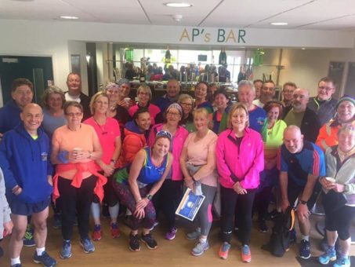
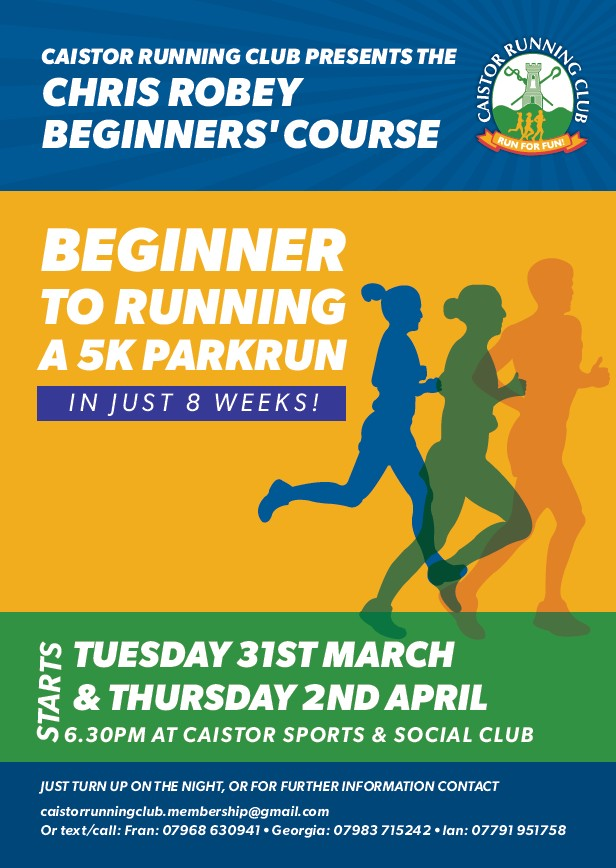

# Caistor Running Club presents: The CHRIS ROBEY BEGINNER’S COURSE 2026

> "A journey of 1000 miles must begin with the first step"
>
> Lao Tzu

Caistor Running Club are pleased to invite you to our 8 week Beginners' Course, developed by Chris Robey.  
  
This is the thirteenth year that we've held a beginners' course, and this course has already helped 250+ people to start their running journeys!  
  
Our course really works and is totally free! It's Caistor Running Club's own version of the Couch to 5K programme, developed by our founder Chris Robey and will culminate in you being able to run the Market Rasen Racecourse parkrun. We try to make it as enjoyable as we can and you'll have our support all the way through. It’s also a great way to make new friends!  

Please don’t worry if you haven’t run much before or think you might not be fast enough. We cater for all abilities, experiences, and ages from 18 to 70 and beyond!

You will be helped by a group of friendly run leaders supported by other Club members during the 8 weeks.

The course takes place on **Tuesdays and Thursdays from 31st March 2026** and we’ll slowly build up the amount of time that you run each week. We also ask all Beginners to do one session a week on their own or with friends / relatives who run with you.

The sessions start at 6.30pm every Tuesday and Thursday and will take between 40 and 60 minutes.

If you’re interested in finding out more about the course or have any questions, please email:  <caistorrunningclub.membership@gmail.com>

*Beginners' class of 2019 at Market Rasen Racecourse parkrun*

Starts 31st March and / or 2nd April 2026, 6.30pm at Caistor Sports and Social Club, Brigg Road, Caistor LN7 6QG.  
  

