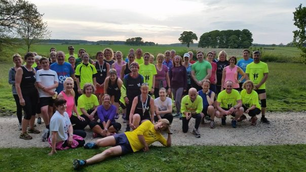

# Home

# Established in April 2011, we are a relaxed, informal club, whose sole purpose is to Run for Fun!

We meet at 6.30pm on Tuesdays and Thursdays and at 8.30am on Saturdays. Our runs are typically on road, however given the proximity of the glorious Lincolnshire Wolds, we also venture off road occasionally. We aim to cater for all levels of ability at every session and strive to ensure that everyone runs at a pace  that they feel comfortable with.

# 

We also realise that for some it’s not just about the running and we also hold many social events, including stopping behind for a drink (or two) after some club nights. We also enjoy quite a lot of cake!

Our members take part in a wide variety of events covering both on road (London Marathon, Great North Run,  Cleethorpes 10K, Croxby Crawl and The Tough 10) and off road (Swaledale Marathon, The Yorkshireman, Ponton Plod, Spires and Steeples, The Gruesome Twosome). It is regular for some of these events to have many Caistor runners taking part, and supporting each other.

## Latest Posts
