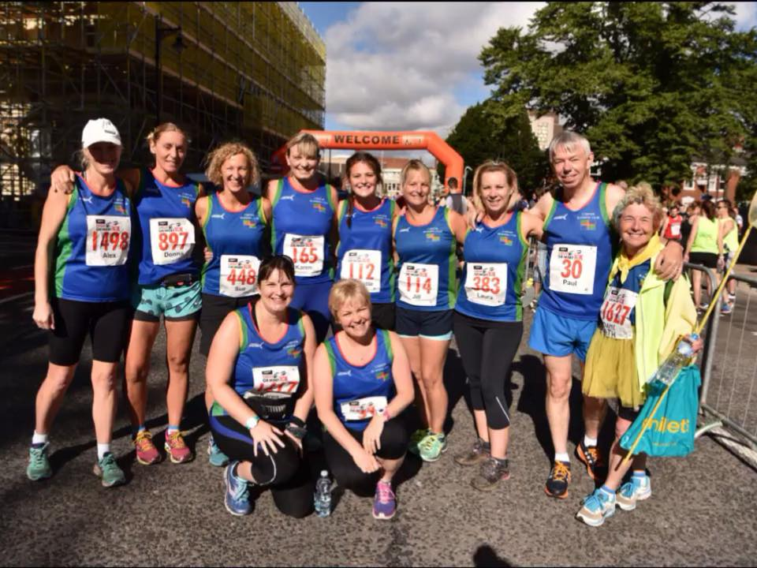

# Membership

## Membership costs just £5 per year

We also request that all members become a member of Caistor Sports & Social Club so that we can use their facilities. This costs £10 per year for an adult, £5 for concessions and £20 for families.

*Team CRC at the inaugural GY10k 2016*

### Membership Form

If you would like to join the club then please download the membership form by using the link below, fill it in and email it to: <caistorrunningclub.membership@gmail.com> or bring it to a club night with your payment.

- [CRC Adult Membership Form 2026](membership/CRC-Membership-Form-2026.pdf)

You are welcome to come along to a few club nights before deciding whether to join.

# Children

Sorry, children under 18 cannot become members of Caistor Running Club, although children can run as guests and they must be accompanied on club runs, either by their parent/guardian or with adults who have agreed to accompany the child and who are nominated in advance by their parent/guardian. One such adult can be responsible for a maximum of two children.

# Testimonials

We are very proud of the progress our members have made. Virtually all our members, particularly the beginners and intermediates, have made significant progress in terms of distances they can run and their speed. Here are some of the things our members have said about the club.

> "Ok, well I joined the beginners course last March in order to get fitter, lose weight and meet a few people at the same time. Quite a few things have happened that I never ever imagined would. Firstly, that I am ENJOYING running on a weekly basis! Secondly, that I have competed in actual running races, both 5k and 10k and have run my furthest ever distance of 11.5 miles too ( and managed a cheeky course record on the Brigg 10k MC ! ) Thirdly, that I would have eaten so much cake and not felt guilty about it !! And fourth, and most importantly, that I would have met such a fantastic group of people who I can now call my friends and who quite honestly, have helped make the last 12 months such brilliant fun. Joining CRC was absolutely THE highlight of my year and I can't wait to continue on this journey. " - **Jayne**
>
> "I came along to the Beginners Course in March with a group of famly and friends and ran for a minute and before I knew it, time had flown by and the course had come to an end and I could run for 30 minutes without stopping. So where am I now? I have run a Half Marathon in September and have taken part in several 10k races, as well as most Saturdays running in our local Parkrun. As well as this I have gained more friends through running with CRC. For anyone who may feel shy or nervous about joining a running club there is really no need. Caistor Running Club is the friendliest and most welcoming bunch of runners you could hope to meet. " - **Chris**
>
> "I didn't think I could run. Seriously. But somehow (probably in the pub) I was gently persuaded (nagged!) by my friend to sign up for the CRC 8 week starter course. She insisted, “anyone can run.” Everyone was really friendly and welcoming and I knew I was truly part of the Caistor Running Club family at week 4 when my cakes met with approval! I was told at that point that I could have the certificate whether I completed the running or not! With encouragement and support from members, I not only completed the course, but ran two 5k races last year, regularly took part in Cleethorpes parkrun and ran the inaugural Skegness 10k in November. I am now a firm believer that anyone can run and would encourage people to give it a go. We run for fun. And cake. And wine. Come on – you know you’re tempted!" - **Cheryl**
>
> "My name is Paul and CRC made me an addict. I'm now addicted to running and cake. Oh yeah, I'm going to run a half marathon this year. Not bad saying I couldn't run around the cricket pitch last March." - **Paul**
>
> "I joined Caistor Running Club in 2012 as the rest of my family had started running so I thought I certainly cannot beat them but may as well join them! I plucked up the courage to join the club on a Tuesday evenings, Thursdays and Saturdays were well beyond my capabilities, or so I thought. Running around the cricket field twice was enough for me to start with. Three years on not only have I made some wonderful friends but with the encouragement of the club have achieved great things, from 5k’s, 10k’s, half marathons and finally Chester Marathon in October 2014, something I never dreamt of achieving! " - **Jill**
>
> "I have always played team sports and viewed running as a solitary activity which was only necessary to keep fit.  I could not have been more wrong! I thoroughly enjoy running with the club.  The camaraderie is great, the enthusiasm is infectious. A pint of Guinness tastes so much better after a good run and in the company of great friends." - **Andy**
>
> "I started at the beginning having trouble to run half a mile but ended up doing the Great North Run in Sept in 2hrs 36mins and have dropped a dress size and feel great. This year I'm doing a few 5 & 10k races and even triathlons for fun!" - **Jenni**
>
> "Before joining Caistor Running Club in May 2011, I'd been running for about a year.   Whilst I was slowly improving, I was becoming stuck in a rut running the same couple of roads.  Since joining the club however my running has significantly improved in terms of both my speed and the distances covered.  I've been shown many different running routes in and around Caistor and further afield.  But most importantly it has introduced me to some great new friends and made running a pleasure which I look forward to." - **Graeme**
