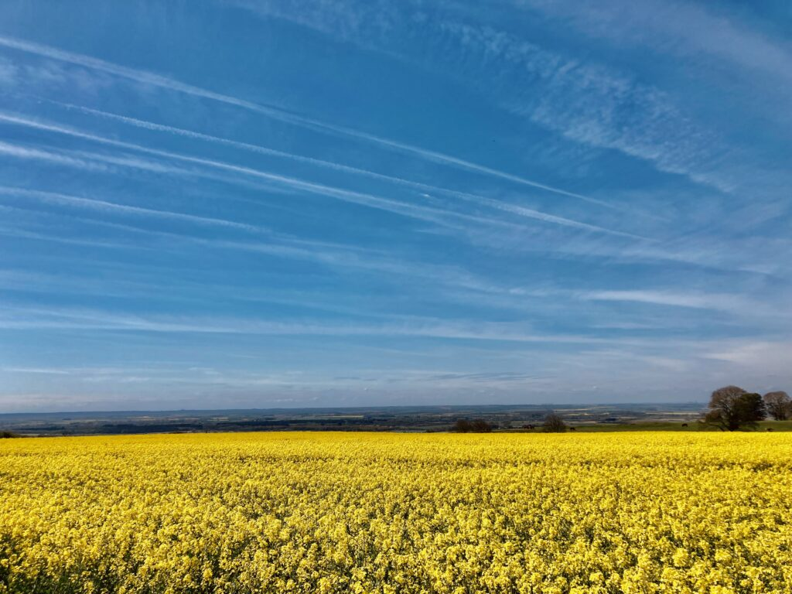

# Mental Health and Support

At Caistor Running Club, we're big believers in the positive impact on health that exercise has for many people, and we know that running and walking can often be a great way to make yourself feel better mentally as well as physically.   
  
We're also aware that sometimes people need more than just a run or a walk, or aren't able to get outside, and we want all our members to know that we're here to talk and to support, whether they are able to make it to club activities or not.   
  
Several club members are Mental Health First Aiders, and others work in mental health services / related areas, so if you feel you need someone to talk to, whether it's on a club run, for a one to one run / walk or just for a talk, please reach out to any of these club members, any time:   
  
Chris Allison  
Fran Allison  
Adam Bromley  
Georgia Chapman-Wells  
Rob Crump  
Rob Payne  
Mike Wells  
  
You can also contact: <caistorrunningclubmentalhealth@gmail.com> if you'd like to get in touch for a chat, or if you'd like to be added to the list above.

*Blue Skies and Yellow Crops - Wold Top*
