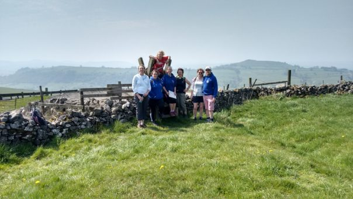
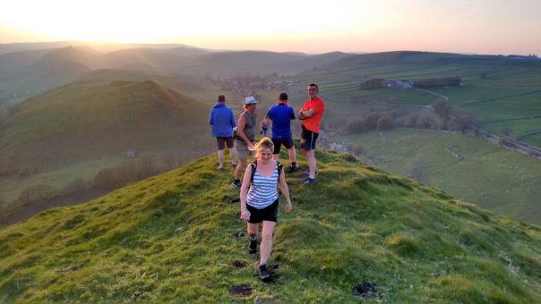

# Walking Section

Hello everyone!  We are part of Caistor Running Club and we usually meet at the Caistor Sports and Social club on Tuesday and Thursday evenings at 6.30pm and on Saturday mornings at 8.30am along with the runners. We generally follow a [similar walking plan to the runners](https://caistorrunningclub.com/training-times/), although covering slightly shorter distances.

The walking section is ideal for any runners coming back from injury, or for those who need to recover after tough training, or competitive races and just need to keep moving.  It's also a great way to get started if you want to take up some activity - to just start walking, or if you plan to move on to running.

*Walking Section do a Stile in Style!*

There are also opportunities to sign up for LDWA ([Long Distance Walking Association](https://www.ldwa.org.uk/)) challenge events which range from 13 to 27 miles. Most walkers who have completed these events would say they are great days out - you get fed and watered during the event and at the end!

So if you or any of your family or friends want to come and join some friendly folks on some very friendly walks come and join us!   Everybody will be made very welcome - we also get to partake in the club social events and some great cake fests.

*Walking Section at Sunset*

You can get in touch with us [using the contact form on this page](http://46.51.166.150/contact/).

We walk for cake!  Just the same as the runners do!
