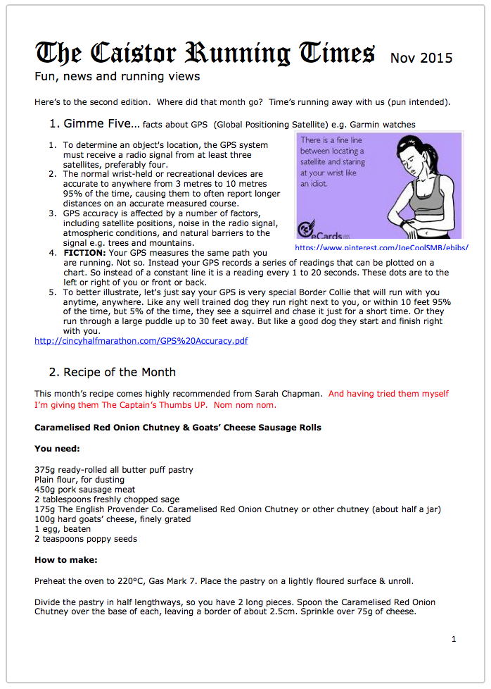

# Caistor Running Times – Nov 2015

Welcome to the second edition of the Caistor Running Club newsletter, The Caistor Running Times. This has been put together by Katy Hewis, our Ladies Team Captain and includes features such as:

- Spotlight - a close up on a club stalwart
- A delicious Goat's Cheese Sausage Roll Recipe
- Injury corner - dealing with heel pain

...and much much more!

If you have anything then please feel free to send in information, photos, tips, in fact anything you think might improve our wonderful club and members!

[Caistor Running Times - Nov 2015](2015-11-01-caistor-running-times-nov-2015/The-Caistor-Running-Times311015Final-1.pdf)
