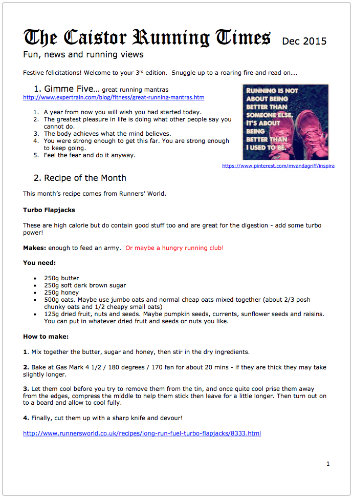

# Caistor Running Times - Dec 2015

Welcome to the third edition of the Caistor Running Club newsletter, The Caistor Running Times. This has been put together by Katy Hewis, our Ladies Team Captain and this month includes:

Valencia race review

A "turbo Flapjack" recipe of the month

Injury corner - hot or cold?

...and much much more!

If you have anything then please feel free to send in information, photos, tips, in fact anything you think might improve our wonderful club and members!

[Caistor Running Times - Dec 2015](2015-12-01-caistor-running-times-dec-2015/The-Caistor-Running-Times301115FinalEd-1.pdf)
