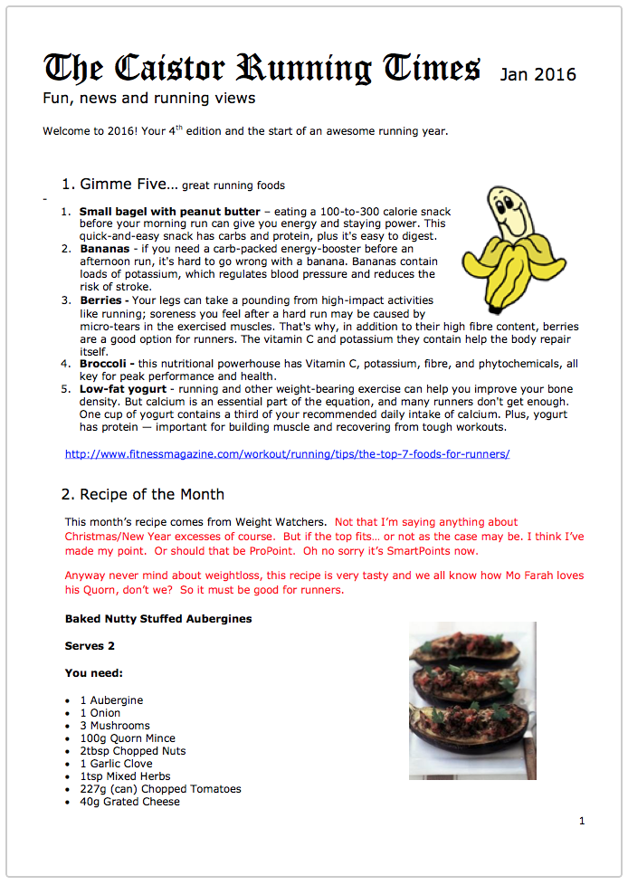

# Caistor Running Times - Jan 2016

Welcome to the fourth edition of the Caistor Running Club newsletter, The Caistor Running Times. This has been put together by Katy Hewis, our Ladies Team Captain and this month includes:

Spotlight on another club stalwart and running legend

An aubergine flavoured recipe of the month

Taking part in the Thunder Run

...and much much more!

If you have anything then please feel free to send in information, photos, tips, in fact anything you think might improve our wonderful club and members!

[Caistor Running Times - Jan 2016](2016-01-01-caistor-running-times-jan-2016/The-Caistor-Running-Times311216Final-1.pdf)
