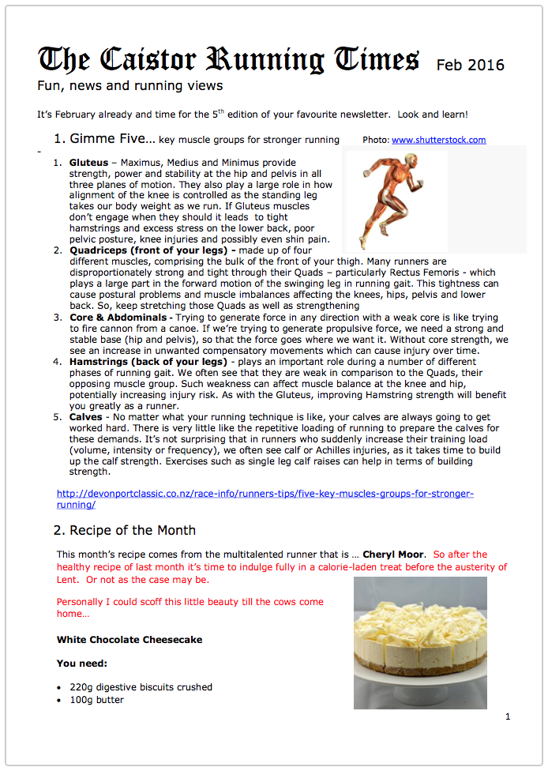

# Caistor Running Times – Feb 2016

Welcome to the fifth edition of the Caistor Running Club newsletter, The Caistor Running Times. This has been put together by Katy Hewis, our Ladies Team Captain and this month includes:

A look at 5 important muscle groups

A recipe for the much sought after white chocolate cheesecake

A round up of the recent awards at the AGM

...and much much more!

If you have anything then please feel free to send in information, photos, tips, in fact anything you think might improve our wonderful club and members!

[The Caistor Running Times - Feb 2016](2016-02-01-caistor-running-times-feb-2016/The-Caistor-Running-Times310116Final-1-1.pdf)
