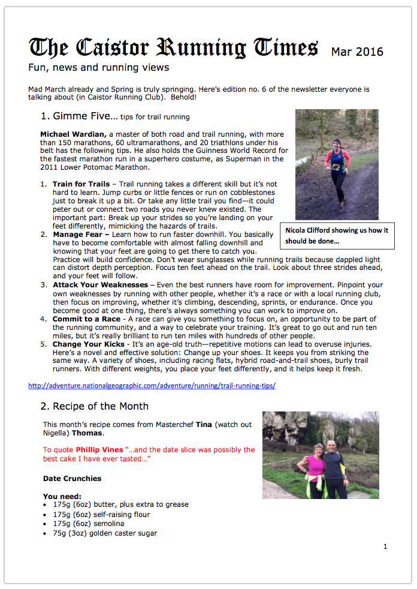

# Caistor Running Times - Mar 2016

Welcome to the sixth edition of the Caistor Running Club newsletter, The Caistor Running Times. This has been put together by Katy Hewis, our Ladies Team Captain and this month includes:

All about painkillers in the injury corner

Write ups about the Caythorpe Dash and Mad Dog 10k Southport 2016

A delicious Date Crunchies recipe

...and much much more!

If you have anything then please feel free to send in information, photos, tips, in fact anything you think might improve our wonderful club and members!

[The Caistor Running Times - Mar 2016](2016-03-01-caistor-running-times-mar-2016/The-Caistor-Running-Times290216Final-1.pdf)
