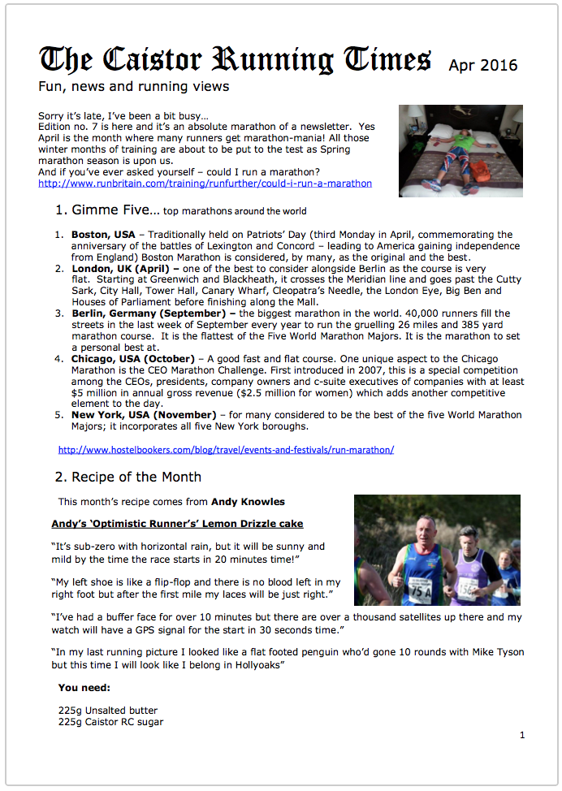

# Caistor Running Times - Apr 2016

Welcome to the April 2016 edition of the Caistor Running Club newsletter, The Caistor Running Times. This has been put together by Katy Hewis, our Ladies Team Captain and this month includes:

A lovely Lemon Drizzle cake recipe

All about the hitting the famous "Wall"

Write ups about the Belvoir Challenge and Keyworth Trail Race

...and much much more!

If you have anything then please feel free to send in information, photos, tips, in fact anything you think might improve our wonderful club and members!

[Caistor Running Times - Apr 2016](2016-04-01-caistor-running-times-apr-2016/The-Caistor-Running-Times310316Final-1.pdf)
