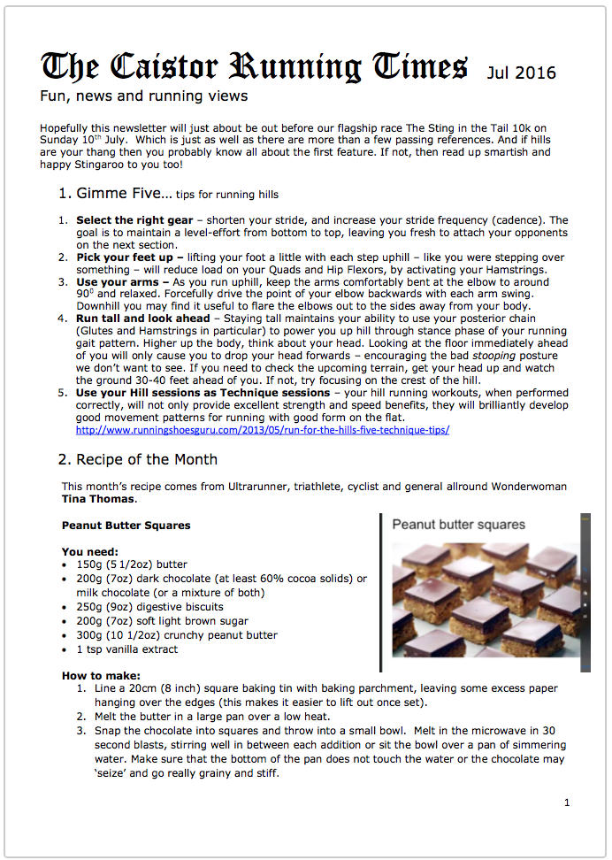

# Caistor Running Times - Jul 2016

Welcome to the July 2016 edition of the Caistor Running Club newsletter, The Caistor Running Times. This has been put together by Katy Hewis, our Ladies Team Captain and this bumper 2 month edition includes:

Tips on running in the sun (haha, yes, I know!)

A focus on the... bladder - seriously interesting reading!

Marathon reports from Manchester, Paris and Boston U.S.A

...and much much more!

If you have anything then please feel free to send in information, photos, tips, in fact anything you think might improve our wonderful club and members!

[Caistor Running Times - Jul 2016](2016-07-01-caistor-running-times-jul-2016/The-Caistor-Running-Times300616Final-1.pdf)
