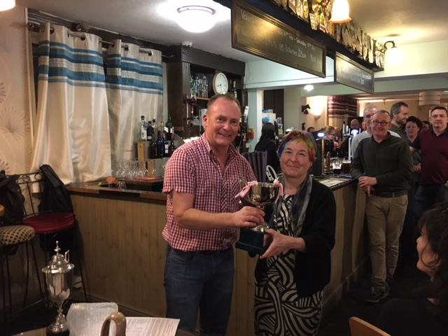
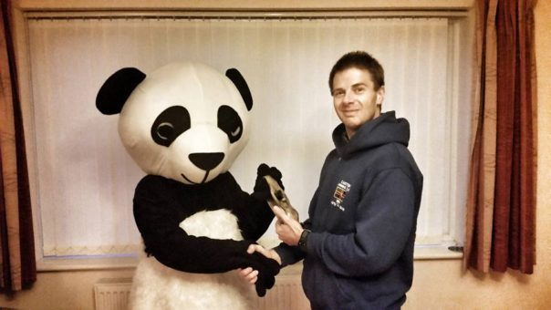

# CRC AGM 2017 - It’s all about the fun

It’s a good job the Moonraiders were doing their sound check when we arrived for the AGM – at least this confirmed we were in the right venue! Five minutes before the meeting was due to start, there were still only 6 of us in attendance. We started to doubt our decision about the need to arrive early to get a seat. However, within the next few minutes, everyone else arrived – Rod last of course – and soon there was standing room only.

The evening was due to kick off with the presentation of cheques from funds raised at the Sting in the Tail 10k to Caistor Lions and Caistor Yarborough School – however, as their representatives hadn’t arrived, this was postponed. Throughout the evening Rod periodically asked, “do we have a representative from our charities yet?” As far as I can recall, they hadn’t arrived by the end of the evening! Money – sometimes you just can’t give it away!

The evening began with reports from the outgoing Chairman, Rod, Secretary and self-proclaimed foreign correspondent, Lydia, outgoing men’s Captain, Andy, ladies’ Captain, Katy, membership secretary, Dame Kath. The organ-grinder, Lorraine was unavailable to deliver the treasurer's report, but she sent her monkey, Andy along and he performed admirably. The necessary important business was done, but as you would expect from CRC, the reports were delivered in an entertaining way, with everyone reiterating that we run for fun. Jill illustrated her report with some excellent photos of the weekend away, bringing back memories for those of us who were there, and capturing the interest of newer members who will doubtless be joining us next time.

One element of the election of officers was amusing to say the least – most people were elected more or less unanimously, with the only ‘against’ votes being recorded by the spouses / partners of those taking on the important roles! I guess they had an idea what they might be letting themselves in for! All tongue in cheek of course.

*Dame Kath receives well deserved CRC "Female Achievement" award for a second year running from CRC Chairman Andy Bell*

The tension mounted during the presentation of the awards as Rod announced the top 3 places in reverse order. The recipients for Male and Female achiever were Nick Martin and Dame Kath respectively. This is the second consecutive year that Kath has received the award – the woman is invincible! The coveted hosting award was won jointly by Neil and Nicola and Frankie and Tina. Despite his best efforts, Frankie did not get hold of the microphone – but I’m sure he knows we all love his work! As though to prove that CRC are an all inclusive lot, the Spirit of the Club was awarded to Robey the (all singing, all dancing, all supporting) Panda! We do not discriminate against livestock. This was collected, in his absence by his keeper, Jayne as Robey is currently away on Ninja Training.

*Robey the Panda receives CRC "Spirit of the Club" award from Mike Wells*

There were some one off special awards this year. Rod presented a mysterious looking box ( the contents of which I am unsure) to Andy Bell and Mark Page in recognition of the support they showed to Derrick Noble and family following Derrick's heart attack during a local race. Rod commended all members who helped, both at the time this happened and afterwards. Ian and Claire Bates collected medals on behalf of their daughters, Martha and Edith, who have been acknowledged as CRC super-supporters, having cheered, waved flags, clapped and cow-belled so many of us over the finish line of so many races.

Food followed (of course) and we were entertained by The Moonraiders for the rest of the evening. The whole evening was filled with laughter, applause, gratitude and lots of chat with running friends. Oh, and the odd drink or two.
