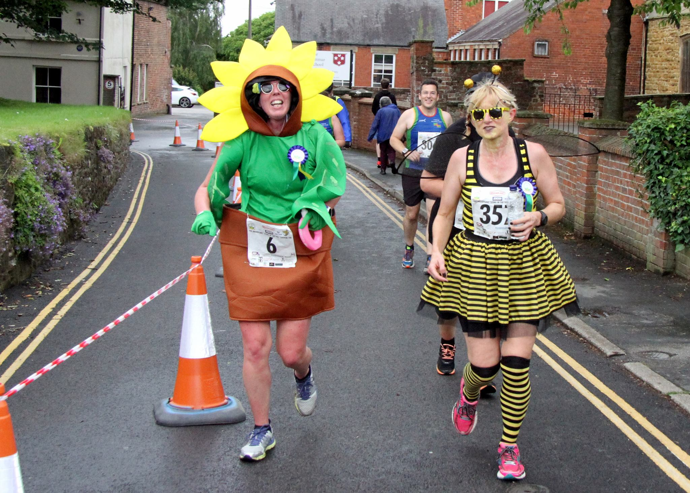

# Sting in the Tail 10k - Entries Open Soon

\*\*\*ENTRIES WILL OPEN SUNDAY 12th FEBRUARY\*\*\*

Caistor R.C. are delighted to announce the date of their annual 10K race.  
The Brianplant "Sting in the Tail" Caistor 10K will start at 10:00 am on Sunday 2nd July 2017.  
It will be the 6th running of this popular local race with a field of up to 500 competing over the glorious Lincolnshire Wolds.

*Sarah & Fran - 2016 Costume Prize Winners*

 

This year's event, which coincides with Caistor's annual street party - "Caistor Goes...Mardi Gras!", will see both the male and female course record prizes roll over from last year meaning setting a new record will win £200!

To help encourage you, for every 10 on-line entries we receive from the same club we will refund 1 place. The organisers will then present these refunds as spot prizes during race registration, based upon the entrant's club.

Please check back here on 12th February for the link to online entries.
