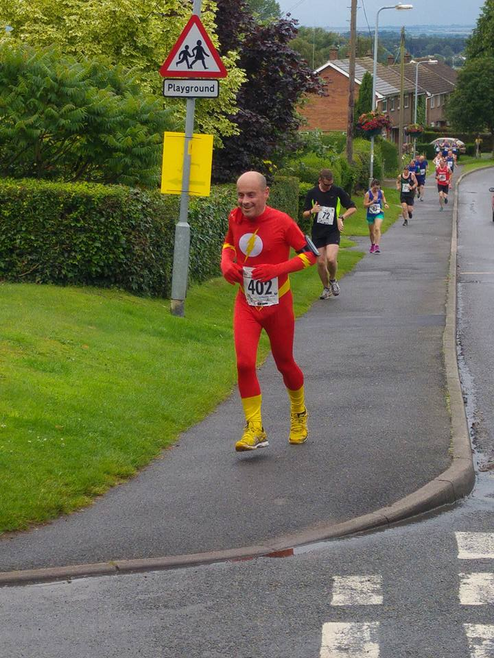

# Entrants' Race Day Information

## The Brianplant “Sting In The Tail” Caistor 10K – 2017 Sunday 2nd July 10:00 am Entrants' Race Day Information

With all 500 places sold out this year’s race promises to be our best ever!  We hope your running has been going well and that you are looking forward to the event.

*A certain Caistor runner enjoying one of the few hills on the course.*

 

Below you’ll find links to race-related information: including the route, a map detailing the car parking arrangements and important information for race day, which all competitors should read.

- [The route can be found here.](http://www.mapmyrun.com/routes/view/743468765)
- [Parking arrangements for the event can be found here.](2017-06-30-entrants-race-day-information/Parking_Walking-2017-1.pdf)
- [The prizes for this year's event can be found here.](2017-06-30-entrants-race-day-information/CRC_10K_Prizes-2017.pdf)
- [Race day information for entrants can be found here.](2017-06-30-entrants-race-day-information/Race_Pack_Instructions.pdf)
- [If you have any queries then please get in touch here.](http://46.51.166.150/contact/)
