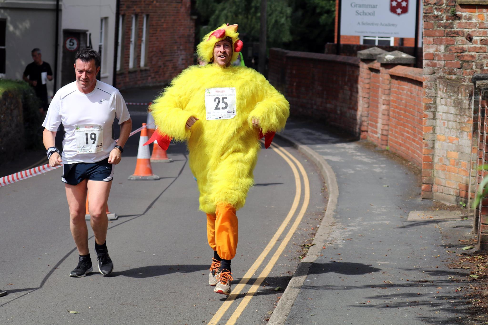

# Sting 10K 2017 - Our Thanks

Our thanks to our sponsors for again supporting The Sting in the Tail 10k race.  We had in total 24 sponsors including Brianplant, John Leggott College , East Trans, Keyo Agricultural Services Ltd., Cristal,  Jewsons, Reynolds Training, Systematic, PK Construction, Hodson Architects, John W Joyce Engineering Ltd, Timber Specialists , Meteodale, Franklin, Made2Measure, Riverside and Broughton Pharmacies, Brigg, B M Electrical Contractor, Sanderson Green, Coast Therapy, The Salutation, Tape2Tape, STALF, Springs Church, and The Settlement.

*Man in chicken suit loving the hills!*

A number of sponsors took up their free places and hopefully the feedback from Rebecca at Cristal will not be atypical.    *I thought it was really well organised and the whole thing had a great buzz about it all (no pun intended!).  Those hills at the finish were a killer though!!!  It was rather warmer on the day than I was expecting too but luckily there were plenty of water stations – in my mind, before the day arrived, I wasn’t planning to take water at the first station but I was really glad of it when I got there!  I got a 10k PB in the end, 52:15 which I could hardly believe given all the hills!    *

*It was good to see everyone with their bottles of Cristal water though - although I confess mine didn’t last long when I got to the finish!  The vests we got were great too.  I would consider entering next year.   *

Hopefully a number of the other sponsors and their associated runners could offer us some stories too?  For example I recall one now member of Caistor Running club entering their first event at last year’s 10k encouraged by a free place and bit of peer pressure?

Also we hope in the near future to hear from the finance team how much of the money taken is going to good causes.  Without the support of the many sponsors this would not be possible.

And finally our thanks to M Hodson, A Knowles, S. Thornley, F Thomas, C. Tattershall, A Reynolds, C & S Robey, L Short, J. Witty, Toni Hamilton, Ali Jenkins, L. Walton, C Moor, C Bates, J Parsons and A. Bell for facilitating the sponsorship and liaising with our many sponsors this year.  Please let K. Brown know if you have any potential leads for the Tough 10.

Russ Tattershall - CRC Secretary
