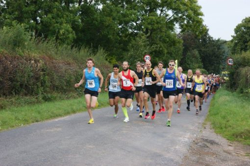

# The Princebuild 35th Lincolnshire Wolds Tough Ten

*Tough Ten Start 2016*

**So you thought Lincolnshire was flat... well think again!!!**

Relish a challenge? Perhaps a 10K is not quite enough? Or you’re training for a half marathon? Then the Princebuild 35th Lincolnshire Wolds Tough Ten is for you!

The course takes you on a ten-mile route through rolling chalk uplands and steep, wooded valleys in the heart of the beautiful Lincolnshire Wolds, an Area of Outstanding Natural Beauty.

The Tough Ten race is in its 35th year and Caistor Running Club, known for the ever-popular [Sting in the Tail 10K](http://46.51.166.150/category/thesting/), are proud to be its new hosts. We succeed Tape2Tape and the Wolds Vets Running Club who are lending their wealth of experience for a smooth transition to ensure the race remains a local favourite.

Entry is just £15 affiliated (£17 unaffiliated) and includes a Lincolnshire sausage sandwich and of course a race memento to take away with you. Proceeds from the race will all go to the [Lincs & Notts Air Ambulance charity](http://www.ambucopter.org.uk/) - a very worthwhile cause in this largely rural county.

**There are just 200 places so don’t miss out!!!**

[ENTER ONLINE - Click Here](https://www.sportsentrysolutions.com/new_race_page.php?recordID=200570 "Powered by Sports Entry Solutions")

So, put the 30th September in your diary and get training… we look forward to seeing you there! Race start is at 10:00.
