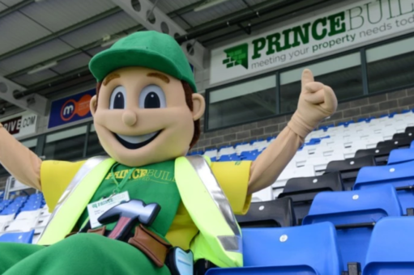

# Princebuild Ltd to be Lead Sponsor of 35th Lincolnshire Wolds Tough Ten

*Princebuild Ltd Mascot Peebee*

Caistor Running Club is pleased to announce that the lead sponsor for the 35th Lincolnshire Wolds Tough Ten this year will be Princebuild Ltd.

Princebuild Ltd specialise in providing a diverse range of services across the construction industry and their business is made up of seven key divisions: Construction, Refurbishment, Insurance, Small Works, Maintenance, Building Services and Renewables. They have a number of offices including a local office at Market Rasen.

Please see here for  the Princebuild Ltd web site: <http://www.princebuild.co.uk/>

**There are just 200 places so don’t miss out!!!**

[ENTER ONLINE - Click Here](https://www.sportsentrysolutions.com/new_race_page.php?recordID=200570 "Powered by Sports Entry Solutions")
