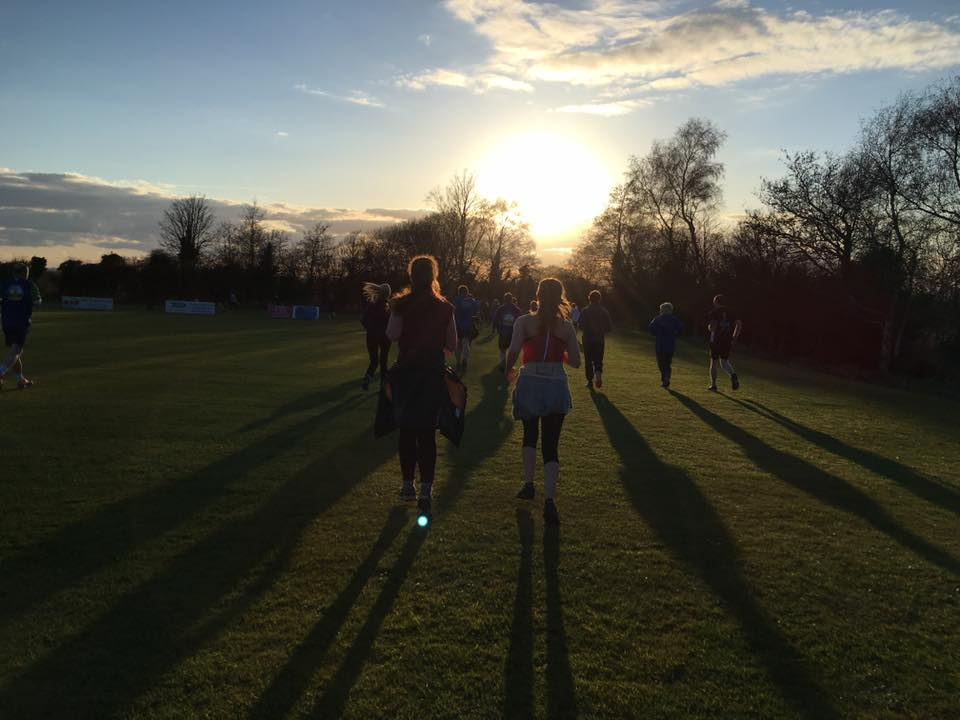

# Start Date Announced for the Beginners Course 2018

We're pleased to confirm that Caistor Running Club are holding our annual beginners course again, now in its 6th year.

*Runners of the 2016 beginners group run into the sun*

It starts on **Tuesday 13th March** (or Thursday 15th if you can't make the Tuesday) at **6.30pm** at the **Caistor Sports and Social Club** (the cricket club) - [see here for a map](http://46.51.166.150/contact/).

It's an 8 week course, and is accessible for all with multiple speed groups to cater for any ability. Absolute beginners are very welcome.

If you'd like more info about the club then [please read here](http://46.51.166.150/membership/) or [follow us on Facebook](https://www.facebook.com/groups/caistorrunningclub).

> After all "a journey of 1000 miles has to begin with the first step"
