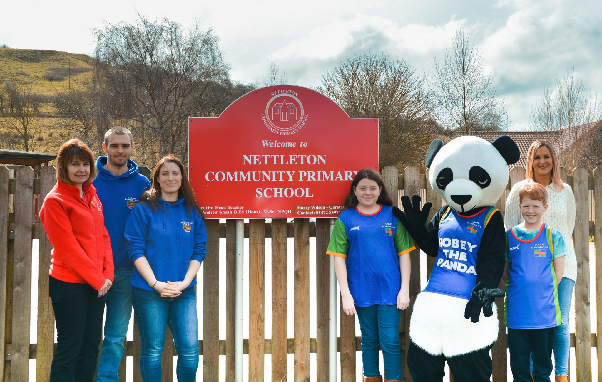

# The 2nd Caistor ‘Mini Sting’ fun run is now open for entries!

The [Rand Farm Park](https://randfarmpark.com/) sponsored event is being held for the second time, alongside the ‘Sting 10k’ on Sunday 8^(th) July.

The course takes in 2 laps of the streets of Caistor on a fully Marshalled route, starting and finishing in the Market Square, where a carnival atmosphere is guaranteed. As a special feature for this year’s race we have included a mad 100m of colourful watery fun which should be welcome on a sunny July day!

The run starts at 9am and is open to all children aged 11 and under, children under the age of 8 should be accompanied by an adult who will run with them around the course. Adults can accompany up to three children and need to pay their own entry fee to take part.

Entry is just £3 per runner and all children completing will receive a goody bag and medal. There are also prizes kindly donated by Rand Farm Park for the winners, as well as special spot prizes for the best fancy dress.

We don’t think you have this much fun anywhere on a Sunday morning for just £3!

Entries are limited to only 250 runners and will close on 18^(th) June so don’t hang around, get your entries in today! Please visit the [Sports Entry Solutions portal](https://www.sportsentrysolutions.com/new_race_page.php?recordID=200840) to sign up.

We look forward to seeing you all on the day!
