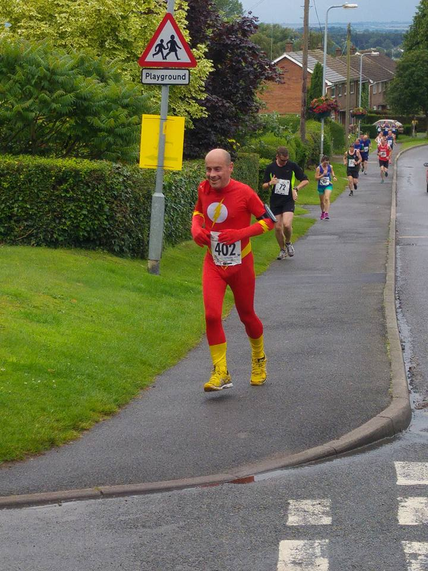

# Sting 10k 2018 Race Day Information

## The Brianplant “Sting In The Tail” Caistor 10K – 2018 Sunday 8th July 10:00 am Entrants' Race Day Information

With all places sold out this for year’s race, we've got a plentiful supply of beer and sausages waiting for you!  We hope your running has been going well and that you are looking forward to the event.

*A certain Caistor runner enjoying one of the few hills on the course.*

 

Below you’ll find links to race-related information: including the route, a map detailing the car parking arrangements and important information for race day, which all competitors should read.

- [The route can be found here.](http://www.mapmyrun.com/routes/view/743468765)
- [Parking arrangements for the event can be found here.](2018-06-26-sting-10k-2018-race-day-information/Parking_Walking-2017-1.pdf) - NOTE: Same as 2017
- [The prizes for this year's event can be found here.](2018-06-26-sting-10k-2018-race-day-information/CRC-10k-Prizes-2018.pdf)
- [Race day information for entrants can be found here.](2018-06-26-sting-10k-2018-race-day-information/Race-Pack-Instructions-2018.pdf)
- [If you have any queries then please get in touch here.](http://46.51.166.150/contact/)
