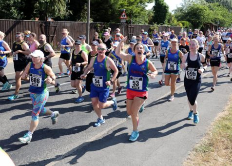

# Sting 10K 2018 - Final Results and Prize Winners

A huge thank you to all of you who took part, either running, supporting or volunteering in the Sting this year. A record field of over 600 ran the main race and over 150 took part in our second running of the Mini Sting fun run.

*Happy runners at the start of the Sting 10k 2018!*

Here are the final outputs for the Sting in the Tail 10k 2018:

- [Individual results](2018-07-23-sting-10k-2018-final-results-and-prize-winners/Sting-Results-2018.pdf)
- [Team and individual prizes](2018-07-23-sting-10k-2018-final-results-and-prize-winners/Sting-Individual-Category-and-Team-Winners-2018.pdf) \*

\* Please note that there has been an update in the ladies team prizes after a reassessment of the results. The relevant clubs and runners will be informed and arrangements will be made to distribute prizes accordingly.
