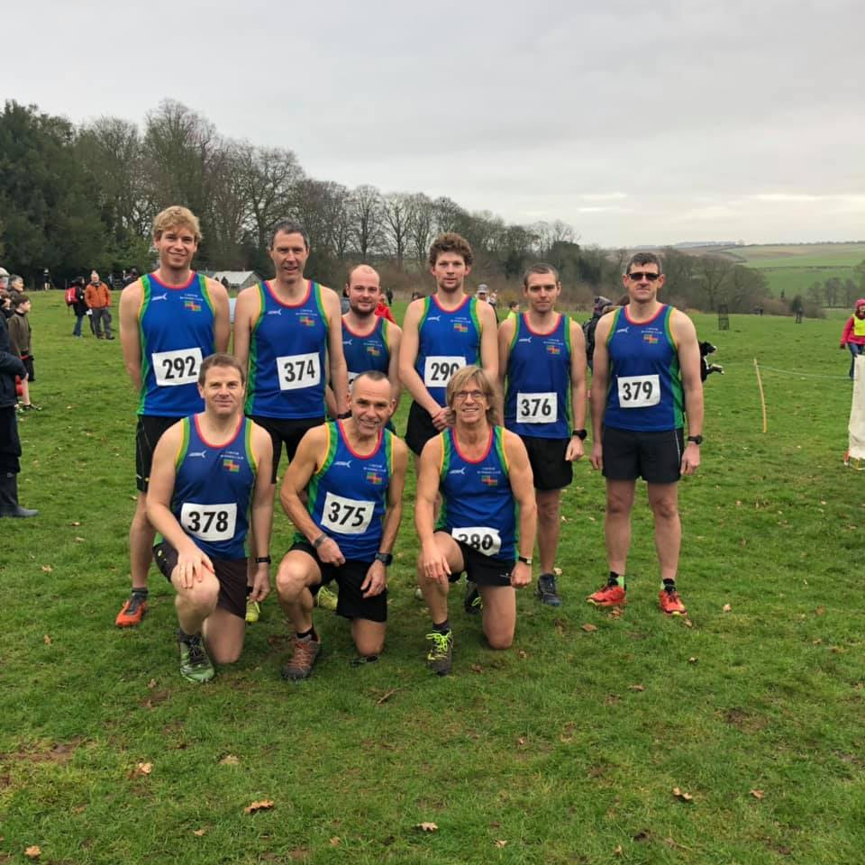
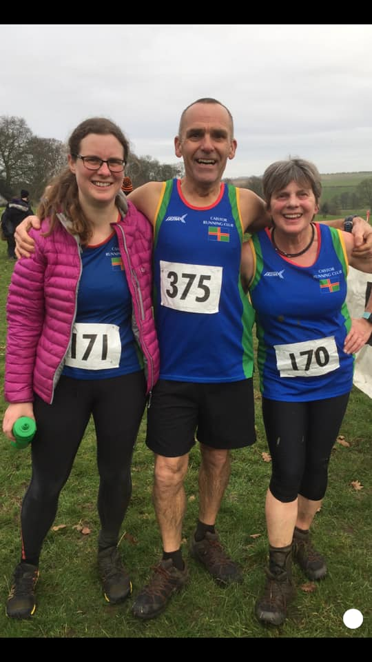

# Caistor Running Club: County champions? Surely some mistake...?

Cross Country running is not usually uppermost in the minds of most CRC members. Nick Martin – CRC Cross Country captain - is a regular at the Lincolnshire League meetings, and has run at the Inter-Counties Championships, and at the Nationals. Apart from periodic outings by substantial numbers of the club to support our friends at Barton & District, at their annual Baysgarth Park ‘Open’ event, only a handful of members sally forth to take on the winter mud.

Inexplicably, over a dozen members entered the 2019 Lincolnshire County championships, run over the challenging course at Biscathorpe. After a few injury forced drop-outs, 9 men & 2 ladies actually took part in the event, run on Sunday 6th January.

All acquitted themselves well, despite the numerous river crossings (12 counted on the men’s course). Ideal bright dry conditions made for fast and enjoyable running, despite the frequent climbs and deep, shoe removing, mud.

The ladies were one short of counting as a team. The men counted as 3 teams, with the more mature finishing as the C team; the slightly quicker ‘twirlers’ and associates as the B team, scoring well within the popular Vets category. But our 3 Senior men – age less than 35 – stormed around the course, with Tom Bell in 26th place, Ultra Runner Rob Payne in an impressive 6th place, and club legend and “Sting In The Tail 10k” champion Nick Martin getting on the rostrum with a fine 3rd place. He covered the 9.3km course in just 32 mins 43 seconds. In so doing Caistor RC became the 2019 Lincolnshire Cross-Country champions.

Anyone for more cake?

***Rod Burton***

Photos of the event are at  
[https://www.flickr.com/photos/46984194@N00/sets/72157675278239047?fbclid=IwAR1U_K6knTQ](https://www.flickr.com/photos/46984194@N00/sets/72157675278239047?fbclid=IwAR1U_K6knTQ%20OngsHnc9b48h0iAOLBlF7slfKHnyFaqzpp-Y5Tkch51FVDJU)  
[OngsHnc9b48h0iAOLBlF7slfKHnyFaqzpp-Y5Tkch51FVDJU](https://www.flickr.com/photos/46984194@N00/sets/72157675278239047?fbclid=IwAR1U_K6knTQ%20OngsHnc9b48h0iAOLBlF7slfKHnyFaqzpp-Y5Tkch51FVDJU)

**Events Coming Up**

Barton & District Open X-C @ Baysgarth Park, Barton – Sunday 20 th January. Noon for women, 12.50 men. Entry £7.00 affiliated, £9.00 unaffiliated. On-line entries only (close 13-1-19). See  
<https://www.sportsentrysolutions.com/new_race_page.php?recordID=200936>

  
National Championships – Harewood House, near Leeds. Saturday 23 rd February. Must be EA license holder, and running for club as 1 st Claim. Entry fee £8.00. On-line entries only – close midnight 11th JANUARY. See [https://www.englishcrosscountry.co.uk/the-national-cross-country-](https://www.englishcrosscountry.co.uk/the-national-cross-country-%20championships/venue/)  
[championships/venue/](https://www.englishcrosscountry.co.uk/the-national-cross-country-%20championships/venue/)
