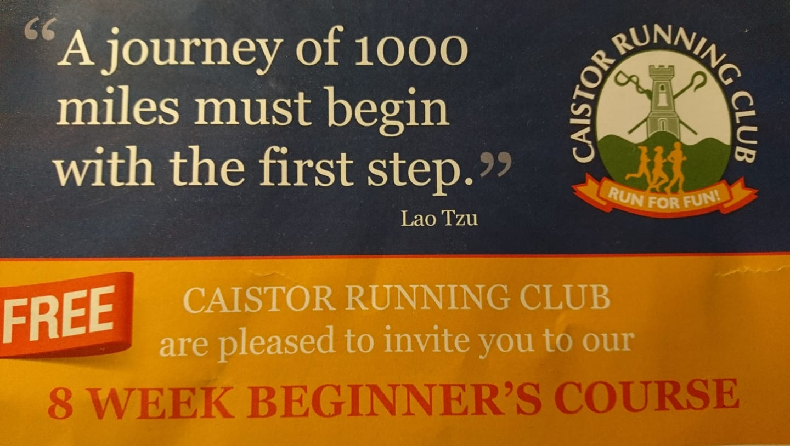

# Start Date Announced for the Beginners Course 2019

The eight-week Couch to 5K beginners course starts:

**Tuesday March 19th and/or Thursday 21st at 6.30pm, at Caistor Sorts and Social Club, Brigg Road.**

The course is aimed at absolute beginners and those wanting to get back into running, with multiple speed groups to cater for any ability. We aim to start from scratch and have you jogging for 30 minutes within the 8 weeks. The course has a fantastic success rate. This is the 7th year it has been put on by the club and over 150 people have successfully completed it, thanks to the gradual build up and friendly help from club members. The course is **free** and open to anyone over 11 years of age. Children between the ages of 12 and 15 should be accompanied by an adult. It will be held on Tuesday and Thursday evenings, but don't worry if you can't make every session as full guidance will be given.

There is no commitment to join the club after completing the course, although many do and some have said it has changed their lives forever!

" *A journey of 1000 miles must begin with the first step*" *Lao Tzu*
