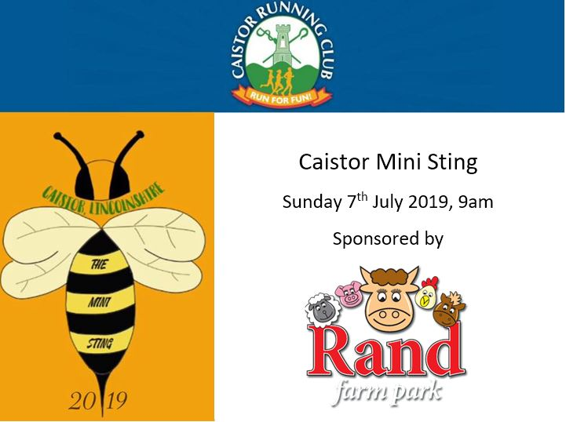

# The 3rd Caistor "Mini Sting" Fun Run is now open for entries!

The [Rand Farm Park](https://randfarmpark.com/) sponsored event is being held for the third time, alongside the ‘Sting 10k’ on Sunday 7^(th) July 2019 at 9am.

The course takes in 2 laps of the streets of Caistor on a fully Marshalled route, starting and finishing in the Market Square, where a carnival atmosphere is guaranteed. As a special feature for this year’s race we have again included a mad 100m of colourful watery fun which should be welcome on a sunny July day!

The run starts at 9am and is open to all ages. Children under the age of 8 should be accompanied by an adult who will run with them around the course. Adults can accompany up to three children and need to pay their own entry fee to take part.

Entry is just £3 per runner and all children completing the run will receive a goody bag and a fabulous bespoke wooden Mini Sting medal. 

There will also be prizes awarded on the day for such things as best fancy dress and although the main aim of this event is a 'Fun' run there will also be prizes awarded for the 1st placed boy & girl, for those that wish to be a little bit more competitive.

We don’t think you have this much fun anywhere on a Sunday morning for just £3!

**To enter online [CLICK HERE.](https://www.sportsentrysolutions.com/new_race_page.php?recordID=201106&fbclid=IwAR0IzGdV3pCow4lzXSzWTcAwlBgyy1QPEUSI5VwXHZzsN2vPhjF8fu2WicU%20)**

We look forward to seeing you all on the day!
