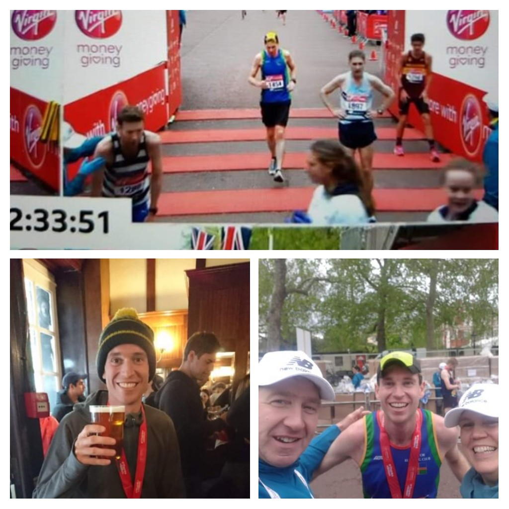
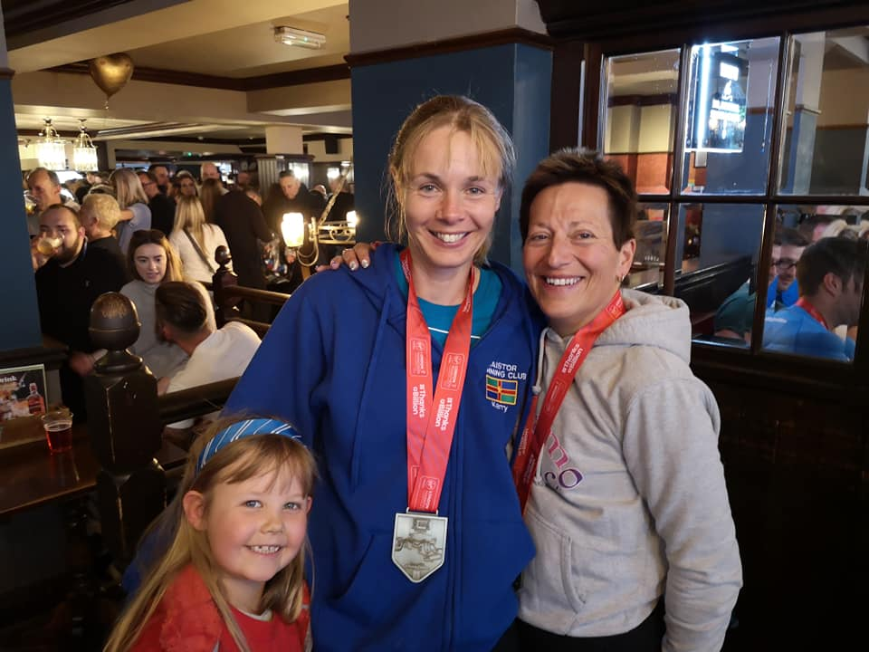
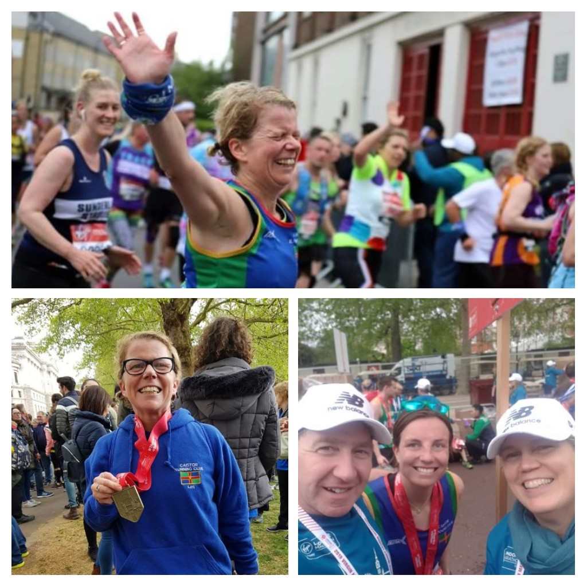

# CRC Members Take London by storm!

Sunday April 28th 2019, the CRC colours were flying proud in the London Marathon. After months of training; highs, lows and setbacks the runners representing Caistor all had a fantastic day. We had chairman Chris Hewis and Katy on official duties too, handing out the "goody bags"and medals to those who'd finished. Family and friends of runners joined the crowds, as did super supporter, Club Mens Captain David Mannion, and good friends of the club, photographer John Rainsworth and Louise Hobson waving the Lincolnshire flag. It's such a boost to see familiar faces in the crowds, cheering you on. Well done supporters too.

Those of us back home were glued to the TV trying to spot Caistor blue amongst the masses of runners. We were also glued to the tracking apps on our phones, being constantly updated on pace, times, splits etc. of those we knew running. Fantastic technology! Its not many clubs can say they were tracking a club member on the same screen as Mo Farah!! But that shows what a fantastic run Rob Payne had. He managed to finish in a time of 2hrs 33 mins and 31 seconds, bringing him home in an awesome 156th position overall........ Well done Rob!

The ladies also had fantastic results. Big congratulations to Emma Bell running the club place, Lesley Turner, Kerry Hallsworth running for The Blue Cross, Moira Westley running for Team Verrico and to Joy Fursman. Well done everyone!

*Super Hero Rob Payne, finishing, collecting his medal from Team Hewis and having his celebratory pint!*

*Kerry Hallsworth and Moira Westley proudly wearing their medals*

*Lesley Turner in action, showing off her medal, and Emma Bell collecting her medal from Team Hewis*
