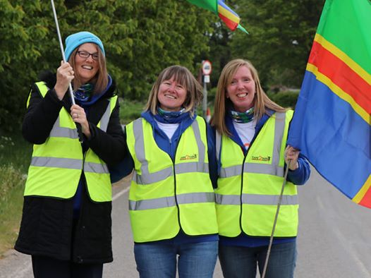
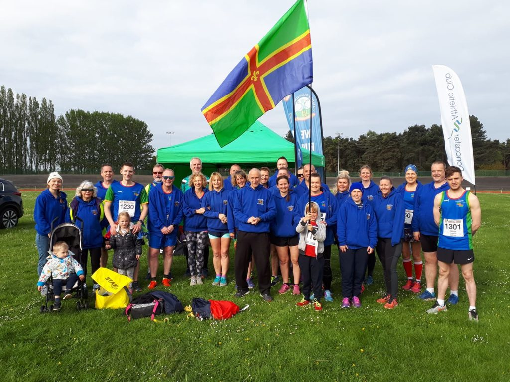
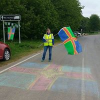
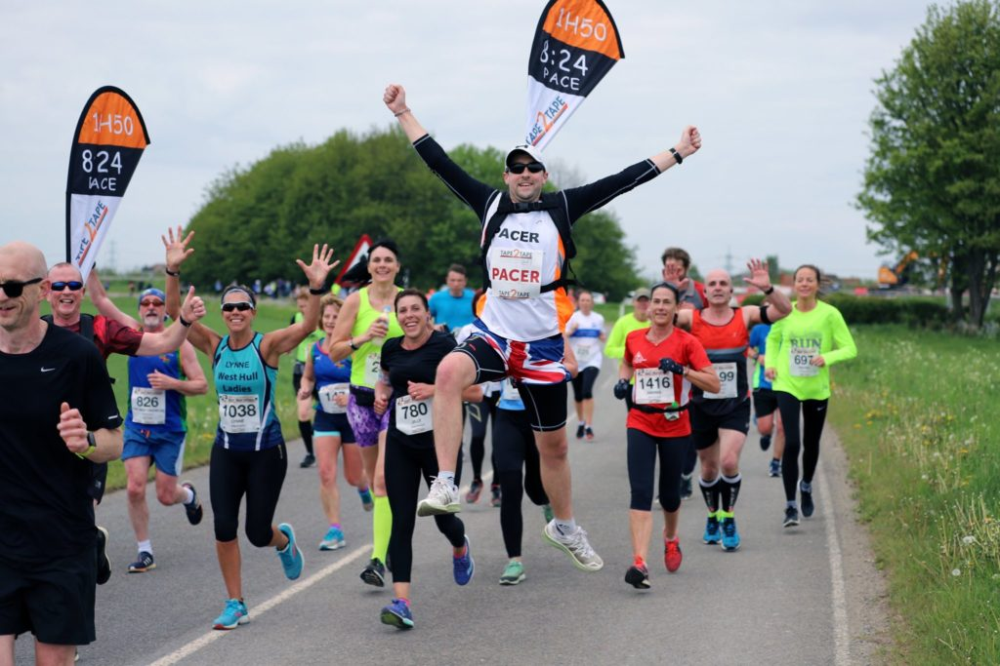
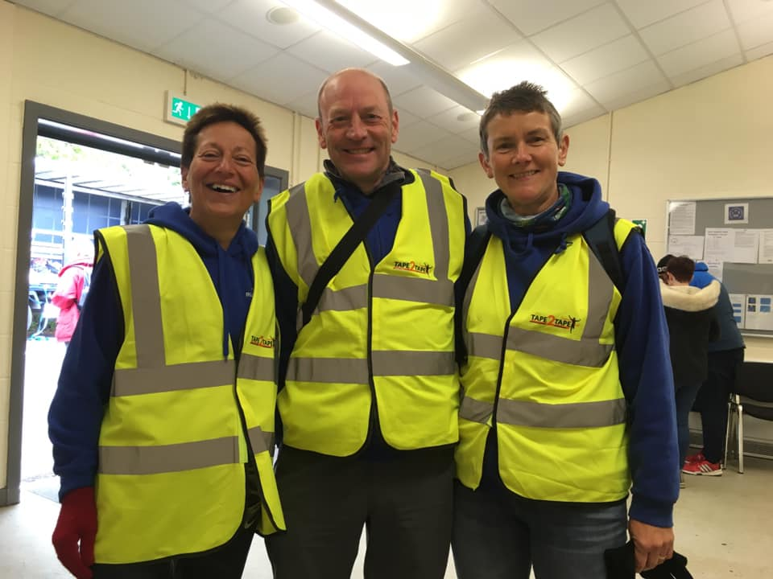
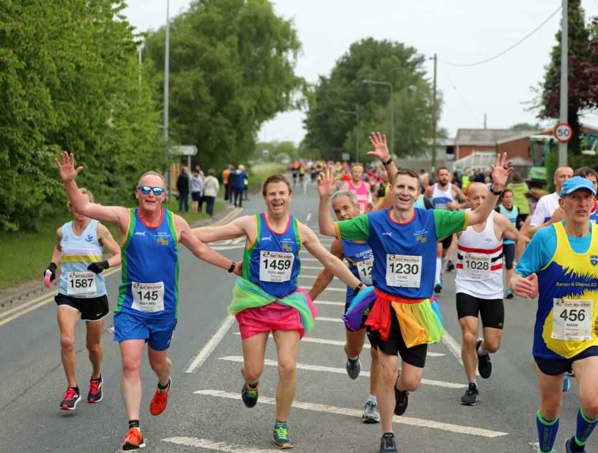

# CRC Out in Force at the North Lincs Half Marathon!

CRC team spirit was flying as high as the Lincolnshire flags being waved by our supporters during last Sundays Tape2Tape North Lincs Half Marathon at Quibell Park in Scunthorpe!

After a day of “changeable” weather on the Saturday, Sundays proved to be perfect for the runners. For some it was their first Half Marathon, and several others achieved PB times.

The Club was out in force with marshals, pacers, supporters and 35 runners on the course. The club flag and gazebo made an excellent focal point for everyone attending. It was a fantastic event as usual, and I think all those who were there felt proud to say they were a member of Caistor Running Club. One to look out for next year.

Here are some comments from social media:

“ I don't think anyone was ever than 20 meters away from a CRC vest/flag/volunteer/supporter/runner today - it was great to see you out in force!"

"I'm feeling SO proud to be a member of CRC right now."

" Great team. Great support and encouragement out on the route today. You're all the best!"

" Honestly what an awesome team to be part of. Team spirit was at an all-time high today! ❤️ "

*Fran Allison on marshal duty with her pavement art.*

## 

*Leaping Pacer Andrew Reynolds*

*Marshals Moira Westley and Nigel & Emma Morrison*

*Caistor boys Andy Bell, Mike Wells and Luke Shillings*

*Pacer Chris Ramsay*
