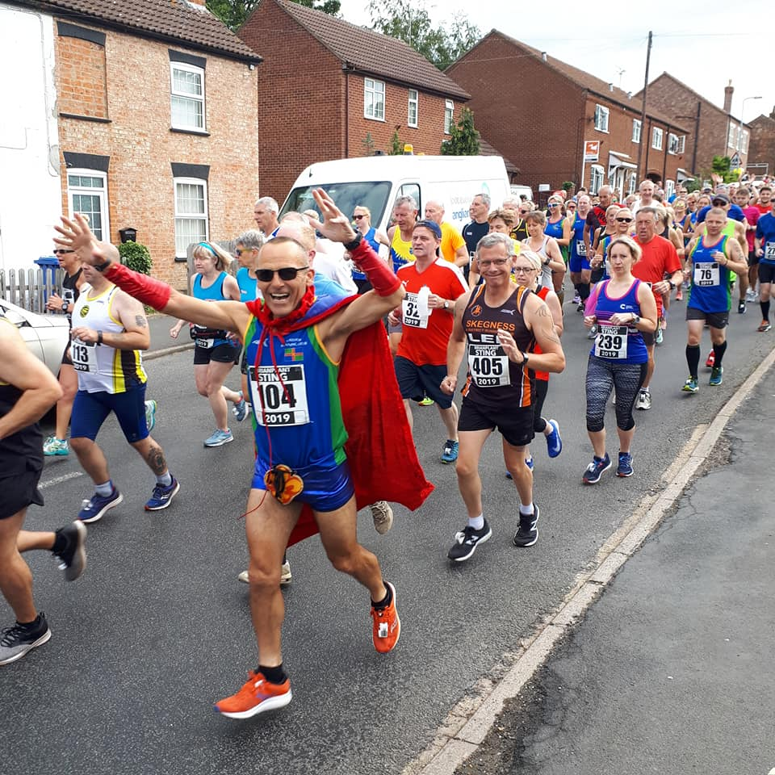
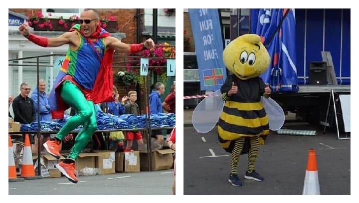
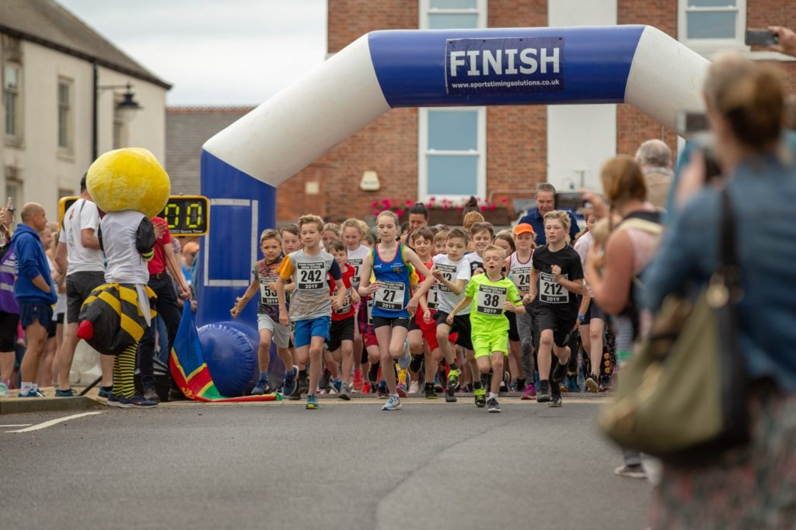
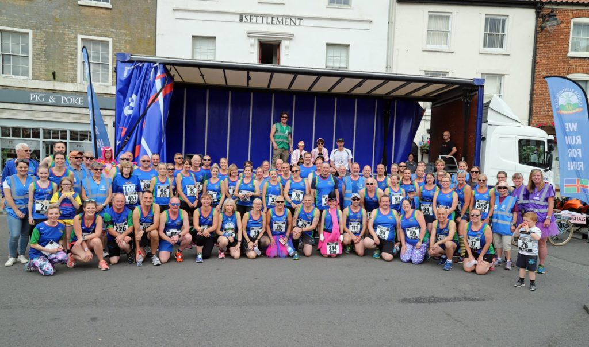
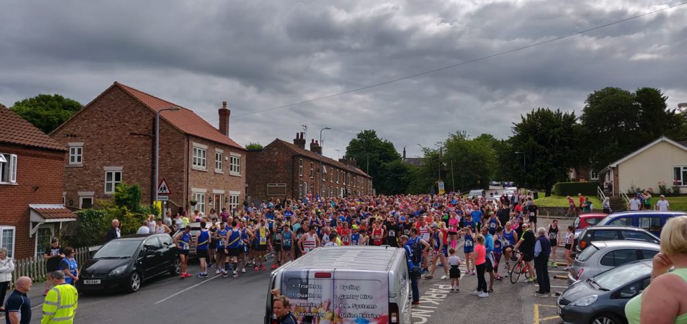
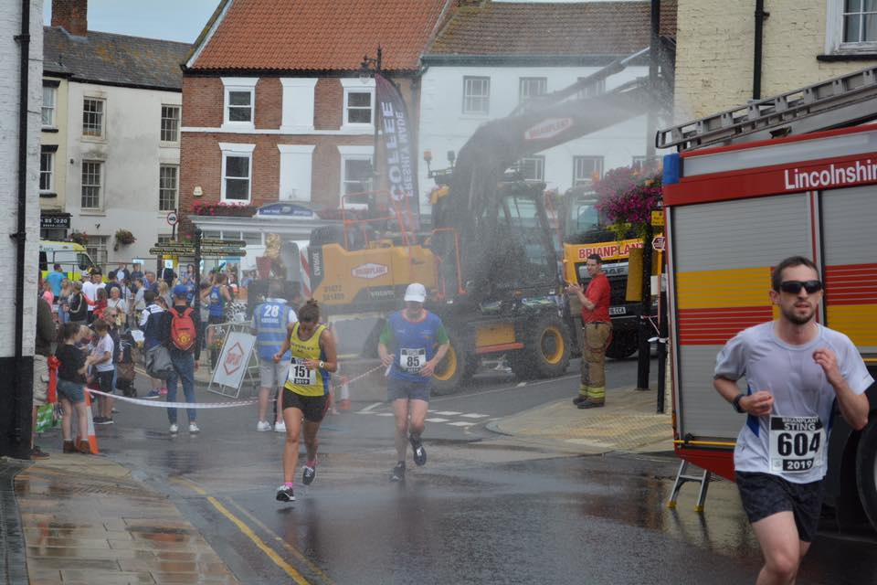

# Caistor "Buzzing" at The Sting and Mini Sting!

There was a record breaking result at Sundays Brianplant “Sting in the Tail” 10K and a record breaking turnout for the Rand Farm Park “Mini Sting” Fun Run.

After months of preparation by race directors Chris Ramsay & Bobby Kneale and Rob & Nadine Crump, the day was again a huge success. The army of helpers and marshals were directed with military precision by Fran Allison and Sarah Wells, making both races run as smoothly as possible. Huge thanks go out to all the club members and their family and friends for helping on the day, without you the events would not take place. Not forgetting those who helped prepare for the event, filling goody bags, sweeping paths, putting signs up etc. This year saw the introduction of chip timing which went down well.

The club would also like to thank again the main sponsors Brianplant and Rand Farm Park.

Participants of both events were treated to the legendary, entertaining warm-ups before the races! Guest appearances by Captain Lincolnshire and Mr Bumble.

*Captain Lincolnshire and Mr Bumble*

*The start of The Mini Sting*

We had 93 members listed as running in the 10K out of 597 finishers, and this didn't include those members running for the sponsors. There was are record breaking 223 participants for the Mini Sting. The children earned themselves a super wooden medal and an amazing goody bag, having great, colourful fun along the way.

There were several members being stung for the first time, and some getting amazing PB’s. The 10k course record was broken by a strong performance from William Strangeway of Lincoln Wellington AC with a time of 31:51, this pushed Caistor’s Nick Martin into second with his PB of 32:18. (A huge 51 seconds was taken off the course record set last year).

Finishers were treated to a bottle of beer and a tasty Lincolnshire sausage bun, in addition to the iconic Sting vest. The atmosphere in the market square was amazing and the support along the way from marshals as well as members of the public was fantastic and well received by runners (as was the cooling spray from the fire engine!)

We have had many positive comments on social media, just a few here:

"A big **congratulations** [Chris](https://www.facebook.com/chris.a.ramsay?fref=gs&__tn__=%2CdK-R-R&eid=ARAgNkEYLn0qnhLQH_PZpTLhUmmFINKnQEyO1xEb-amrx_xtVsrd_f36amwUkAk0EVML-k4R7y_-ueRI&dti=264834156866859&hc_location=group) & [Bobby](https://www.facebook.com/bobby.kneale.1?fref=gs&__tn__=%2CdK-R-R&eid=ARAfjLbo8Y08rCKTyu79vNxNym0Ggu2p7cPUBCdpJTQyu_X1VvxfAMpn00URAxmu5hlT99zHIiTVmdHH&dti=264834156866859&hc_location=group) and the army of volunteers for organising a fantastic event yesterday. Ran like clockwork."

**"Congratulations** Caistor on another brilliant event."

“Thanks to all at CRC for putting on an awesome race”

“We had the best time. The whole atmosphere and event was amazing”

“Had such a great time today doing the sting” 

“Great route, fantastic support from marshalls and locals”

**“Congratulations** on a fabulous 2019 sting! It was my first time and I was really impressed at how well organised it was.”

“Fantastic well organised race with great support throughout, thank you” 

Keep a look out for news of next years event and make sure you get in early to be a part of what is sure to be THE event of 2020! (This year’s races both sold out very quickly).

Thanks go to:

Sponsors of the 10k:

Brian Plant, Tronox, Systematic, Lenzing Fibres, East Trans, Jewsons, Timber Specialists, PK Construction, Keyo Agricultural Services Ltd, John W Joyce Engineering Ltd, Franklin College, Reynolds Training, Build Base (Milton Keynes Branch), IRJ Construction, Hodson Architects, Riverside and Broughton Pharmacies, Brigg, Think Active, Bfit Gym Lincs, TWB Electrical, The Salutation, Tape2Tape, Coast Therapy.

Sponsors of the Mini Sting:

Brigg Garden Centre, Len Hope Plumbing, The Forge, Blackrow Engineering, DFDS (water), Lydia Walton (bags), Systematic Print Management (training plans & flyers).
