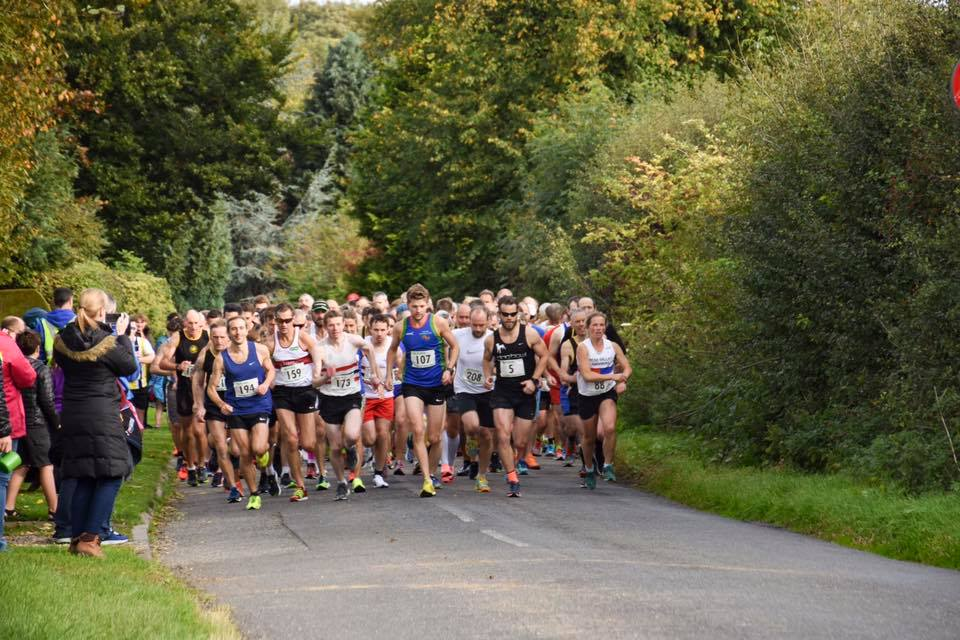
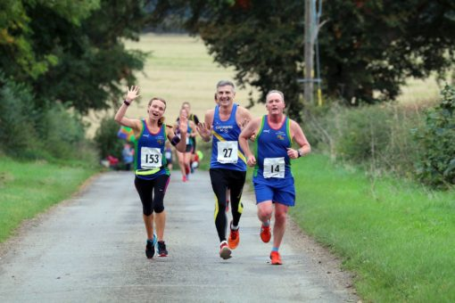

# RD's Race Preamble

As the days count down to the Wolds Ten on 22nd September it’s a flurry of activity of course  
checking, sign checking, marshal checking, entry checking, water station checking and prize  
checking. In fact, if there’s something that needs to be checked then it will be.

*Helen & Andy on the W10 2018*

As everyone knows a good race needs runners and we look forward to welcoming not only  
those who have done it before but also anyone who is looking forward to their first time.  
Our marshals are second to none, not only encouraging every runner, from the first to the  
last, but also carrying out the crucial role of making sure that the race proceeds as safely as  
possible.

But runners and marshals are only part of the equation. Quite simply we couldn’t put on an  
event such as this without the support of our fantastic sponsors.

Our lead sponsor Nunns, the Mazda and Mitsubishi car dealership, have been fantastic in  
their support and are also providing a lead car on race day. We’ll be mounting a race clock  
on its roof so those at the front can see how they’re doing on the way round. If you fancy  
buying a new car then they’ll have a few on display for you to have a look at.

Not only are The Social Kitchen allowing us use of their car park as our race HQ and finish  
area but they’re also providing hot dogs for every runner after they finish. If you fancy a  
pint or maybe a meal then they’ll be serving in the bar.

A race wouldn’t be a race without water stations en-route and we’ve got Tronox to thank for  
keeping everyone hydrated and the Explorer Scouts from Grimsby and Cleethorpes who’ll be  
handing it out.

There are always bits and pieces that need paying for whether it’s toilets at the start or race  
goodies at the end and we’ve been lucky enough to get cash sponsorship from Lucas  
Machinery, Knapton Wright and Drury Engineering.

Finally, the route map that we post on Facebook has been put together for us by Scotts  
Property so if you go out for a training run and get lost it’s their fault!

Hopefully that gives you a bit of an insight to some of the supporters behind the scenes  
helping us to put on this great race. See you on the day!

Kate Brown, Race Director for CRC's Lincolnshire Wolds Ten Race
