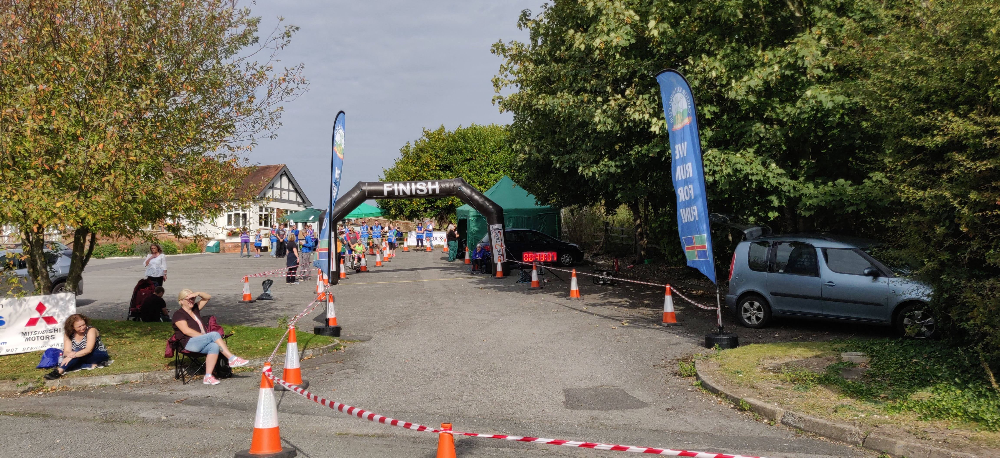

# Wolds Ten 2019 Results

*Finish line, all ready for some runners to appear!*

Thank you to everyone who ran, volunteered or supported at the race today. The conditions were not entirely benign this morning; stronger than expected sunshine certainly made for a hot run out there in the Wolds of Lincolnshire, but the number of smiling faces over the finish line seem to indicate that most had a good time over the ten miles of testing tarmac.

Without further ado, [please find the preliminary results by clicking this link](2019-09-22-wolds-ten-2019-results/The-Nunns-Lincolnshire-Wolds-Ten-Results-Individual.csv).
