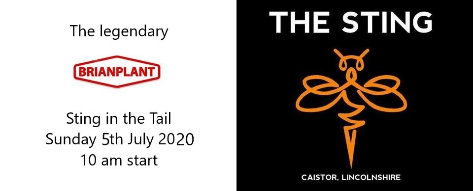

# Brianplant Sting in the Tail 2020 10k Now Open!

Entries are open for the challenging, but very friendly "Sting in the Tail 10k". Once again generously sponsored by Brianplant and a whole host of other businesses, this event promises to be more exciting than before, with a new "King of the Sting" challenge for the 2020 race.

As usual, the iconic Sting vest, a beer and a sausage will be on offer for successful finishers. The race will once again be chip timed.

Go on, get entered now before it sells out!
