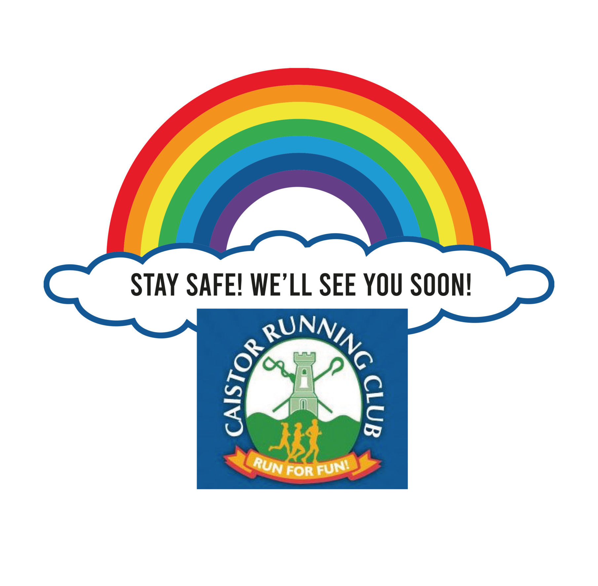

# Covid 19 and CRC

Due to the unprecedented situation we are currently find ourselves in during this pandemic, the club is, as you are aware, following Government guidelines to help prevent spread of the virus. All club face-to-face activities have been suspended until further notice.

The Committee is working behind the scenes to keep the club together during a time when we cannot run together, no easy task. Much of this is being done daily with the help of members input on the club Facebook page, but when appropriate emails will be sent out as invitations to virtual events and activities as we are aware some members do not use Facebook.

Here is a new look newsletter appropriate for our current situation.

[CRC-Bitesize-April-2020](2020-04-24-covid-19-and-crc/CRC-Bitesize-April-2020.pdf)[Download](2020-04-24-covid-19-and-crc/CRC-Bitesize-April-2020.pdf)
