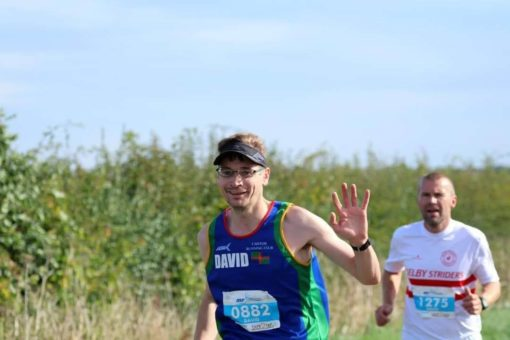

# David Mannion Memorial Mile Series

This will be a series of three one mile races, to take place on three consecutive Wednesday evenings with the first race being held in the week after the clocks go forward in March. This series will take place at the Caistor Sports & Social Club sports field on a measured course. For the moment, this series is open to CRC members only.

*David Mannion running at a local race in CRC colours.*

The dates of the series are as follows:

- Wednesday 30th March at 18:30
- Wednesday 6th April at 18:30
- Wednesday 13th April at 18:30 (with a presentation post-race)

Runners will be judged on their highest age grade score across the race series - [so come and have as many goes as you want!](https://forms.gle/V1qjhDEr12X4Nwqv5)  
  
There will be one male and one female shield which will be engraved with the year and the winner's name.

Please note that the Caistor Sports and Social Club will be open; we are encouraging people to use the facilities and make these a social event as much as a race meeting.

These 2 shields are being very kindly bought and donated to the club by Moira Westley and Rob Cartwright.

The winner of one year will be ineligible to enter the following year and instead encouraged to volunteer. Thereafter they may compete again.  
  
To enter this year's races, please **[click here](https://forms.gle/V1qjhDEr12X4Nwqv5)**  
  
There will be no race fee: runners wanting to enter a race will be asked to make a donation to a collection for MIND and the National Autistic Society:

- [Donate to the National Autistic Society](https://www.justgiving.com/fundraising/nat-autism-society)
- [Dontate to MIND](https://www.justgiving.com/fundraising/dm-mms-mind)

Although much of the above is regarding the winners, we hope that this will be a fun event with an encouraging and supportive atmosphere for all who take part.
