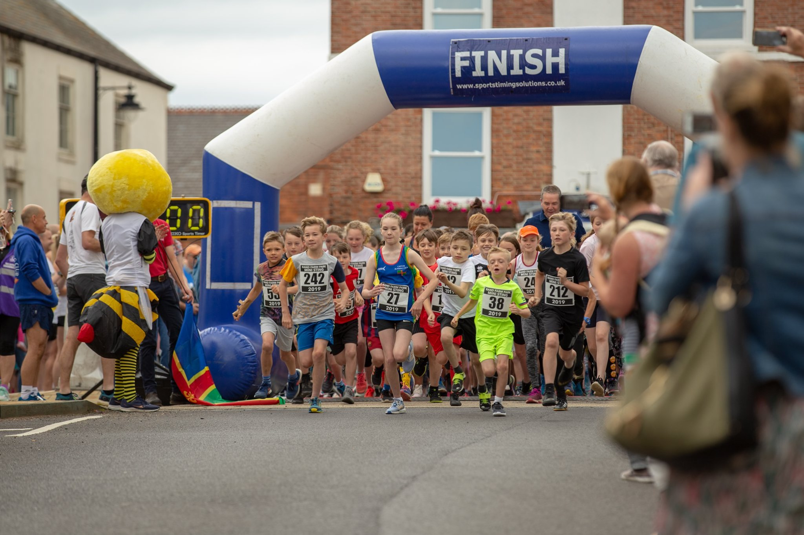

# Brianplant Sting and Mini 2022 Sting Entrant Info

**Race information update - please read carefully!**

## Number Collection

**Race numbers are not being posted out to you - please collect them in person if you can, before the day!**

We are encouraging participants (if you are locally based) to come and collect race numbers for the Sting and Mini Sting in advance of the race day (Sunday July 17th) is possible. There are two opportunities to come and collect your race numbers before race day:

- Thursday 14th July 1900 to 2100 -  at the Caistor Sports and Social Club, Brigg Road, Caistor
- Friday 15th July 1900 to 2100 - at the Caistor Sports and Social Club, Brigg Road, Caistor

At the Sports and Social club there is car parking and the bar will be open if you want to stop for a drink and have a chat etc.

On race day itself:

- Sunday 17th July, 0800 to 0940 (Race Day) at the Caistor Town Hall (Race Start Area)

## COVID

Please do not attend the race if suffering with COVID or suspected COVID symptoms!

## Car Parking

Car parking is available at a number of locations please follow the instructions of the marshals:

**Caistor Yarborough Academy (LN7 6QZ)**

From the car park at Caistor Yarborough School it is a 10 minute downhill walk to the Caistor Town Hall on Grimsby Road.  
DO NOT PARK ON GRIMSBY ROAD ITSELF PLEASE!

[Embedded map](https://www.google.com/maps/embed?pb=!1m18!1m12!1m3!1d2373.371994408073!2d-0.31226668415585723!3d53.497549980010966!2m3!1f0!2f0!3f0!3m2!1i1024!2i768!4f13.1!3m3!1m2!1s0x48788f73c0864413%3A0x8a6288b363093042!2sCaistor%20Yarborough%20Academy!5e0!3m2!1sen!2suk!4v1657617770981!5m2!1sen!2suk)

**Caistor Playing Fields (Off North Kelsey Road)**

From the playing fields, it is a 5 minute uphill walk to the Caistor Town Hall on Grimsby Road.  
DO NOT PARK ON NORTH KELSEY ROAD ITSELF PLEASE!

[Embedded map](https://www.google.com/maps/embed?pb=!1m18!1m12!1m3!1d2905.177765067663!2d-0.32442586809123014!3d53.496916762566556!2m3!1f0!2f0!3f0!3m2!1i1024!2i768!4f13.1!3m3!1m2!1s0x0%3A0xd5db34c2c617831!2zNTPCsDI5JzQ5LjMiTiAwwrAxOScyMy4wIlc!5e0!3m2!1sen!2suk!4v1657617987151!5m2!1sen!2suk)

## Changing & Toilet Facilities

Changing & Toilet Facilities: Limited WC's are available at Caistor Town Hall – please respect the environment and use the toilets provided, NOT nearby private properties. No showers are available.

## Baggage

Baggage storage will be available at Race HQ, Town Hall.

## Race Start

**Mini Sting:** The will start at 09:00 from the Market Place in Caistor.

**Sting 10k:** The race will start at 10:00 prompt from Nettleton Road, Caistor, approximately 300m from the Market Place in Caistor. 

## Headphones

Headphones are not permitted on this race, due to some of the race route having traffic - you will have to be able hear instructions from marshals. Please do not risk being disqualified by wearing them!

## Courses

**Mini Sting Fun Run:** 2 laps of an approximate 1km course, starting and finishing in Caistor Market Place.

**Sting 10k:**10 kilometres, as certified by UK Athletics. The course will be fully signed and marshalled. The start is on a wide road with the first 100 metres being downhill. After that the first 6 kilometres are mainly flat, on a mixture of tarmac path, road, and unmetalled track. Please be aware that the surface is uneven in places and care should be taken at all times. The last 2 kilometres include a number of sharp inclines. The finish is in Caistor market place. Each kilometre will be marked. There will be a “Sweep” vehicle/cyclists behind the last runner.

## Road Closures

**Obey all marshall instructions - you DO NOT have right of way over traffic at any time!**

Be aware that road closure orders are not in effect for 1000m from the town boundary westwards on the North Kelsey Road. Please be aware of, and considerate towards, all road traffic. Entrants must use footpaths where they exist; run on the left of any road where no path exists, unless otherwise instructed; and obey the marshal's instructions - on penalty of disqualification. Full road closures are in place for the majority of the final 2 kms, supplemented by coning and marshals to assist any road crossings.

## Water Stations

Will be available at 3.2, 6.4 and 8.5kms, with water being supplied at the finish also.

## First Aid

First Aid facilities are provided by Mobile Medical Cover Ltd with two ambulances and a team at the Race Finish and a covered station at the Grammar School by the church, with supplementary resources out on the course provided by other agencies. 

## Finish

**Mini Sting:** Will be in Caistor Market Place

**Sting 10k:** Will be in Caistor Market Place. Please follow the directions given by marshals to ensure a smooth conclusion to your race. Race H.Q. will be located in the Town Hall. 

## Prizes

**Mini Sting Fun Run:** Prizes awarded for first girl and boy, as well as various spot prizes. Everyone gets a medal and a goody bag!

**Sting 10k:** Prizes will be given to the top three male and female finishers. In addition, there will be prizes for teams, various age groups and best fancy dress! Total prize money of over £900.

[See this document for details.](2022-06-18-sting-and-mini-2022-sting-entrant-info/CRC-10K-Prizes-2022.pdf) 

## Presentation

Will take place in the Market place at 1200.

## Results

These will be posted to the Club’s website ([www.caistorrunningclub.com](http://www.caistorrunningclub.com)) following the conclusion of the race. 

## Refreshments

Will be available at various outlets in and around Caistor market place.

## Race Licenses

- [Sting 10k Race License](2022-06-18-sting-and-mini-2022-sting-entrant-info/Sting-2022-Race-License.pdf)
- [Mini Sting Fun Run Race License](2022-06-18-sting-and-mini-2022-sting-entrant-info/The-Mini-Sting-2022-License.pdf)
