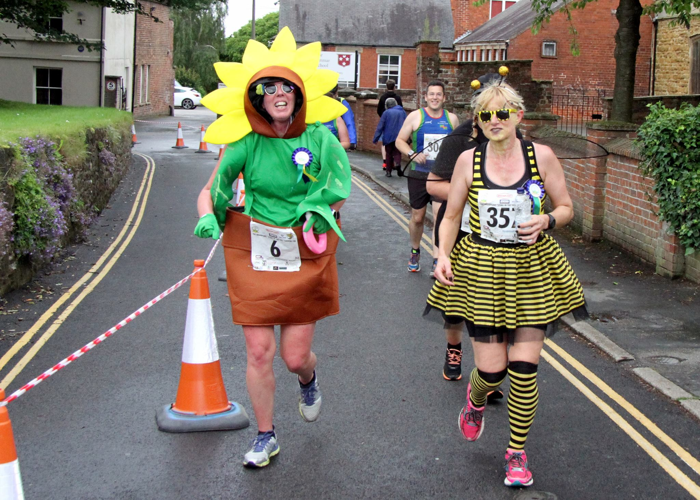

# Brianplant Sting 2022 / Mini Sting Fun Run - Hot Weather

It’s looking increasingly likely it will be very warm for the Sting 10K and Mini Sting Fun Run this Sunday. Temperatures are forecasted to peak at possibly up to 30 degrees, meaning conditions will be more difficult for running.

If you are running, please read the advice below carefully and take steps to ensure you are ready.

## Hydration

It’s essential to stay hydrated not only on race day, but in the lead up to Sunday. Ensure you’re drinking enough water when doing any exercise this week. Dehydration is not just a result of not drinking enough on one day, but a result of not taking on enough fluids over an accumulation of days.

Dehydration can lead to several dangerous symptoms including heatstroke, nausea, headaches and dizziness. Our route will be have 3 water stations to give you opportunities to rehydrate and steer clear of those symptoms.

Consistent fluid intake in the lead up to the race as well as minimising your alcohol intake reduces your risk of dehydration. Don't overdo things either, just drink to thirst.

## Effort Levels

Please ensure you’re sensible and avoid heat exhaustion. With the weather expected, it would be sensible to adjust your 10K goal and reduce your overall effort. If you feel like the heat is having an impact on your running, please take the time to stop and take a break in a shady spot.

If you feel like dropping out would be the safest option, locate your nearest marshal (if possible). Likewise, if you see a runner in distress – please alert the nearest marshal.

Sensible effort levels should reflect in your warm up and final training preparations too. In order to stay hydrated, it’s important not to over-exert with any exercise that may have a long-term effect on your ability to run on Sunday.

Consider whether you take part at all if you have been unwell recently, and speak to your GP if you have a pre-existing medical condition which may be exacerbated by running in warm conditions.

## Sun Protection

Runners taking part in the 10K will be in the sun for approximately 1 to 2 hours between 10:00 – 12:00. Those taking part in the Mini Sting will be out in the sun between 09:00 – 09:30, during a slightly cooler part of the day. Please bring sun cream and apply regularly if you’re likely to be out in the sun for a prolonged amount of time.

## Clothing and Body Temperature

Much of the effort will be staying cool. Wear appropriate running clothing and give your body the best chance to stay cool during the race.

## Spectators

If you have friends and family coming along for the day, please make sure they bring plenty of water and read this advice too.
