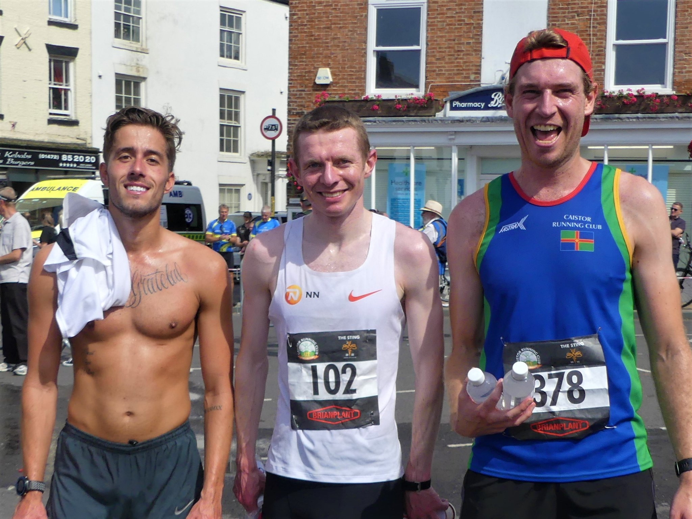

# Brianplant Sting in the Tail 10k 2022 Prize Winners

Well done and congratulations to all who took part, and a special well done to those who won a prize!

*Male winners Will Strangeway (M), Ryan Page (L), and CRC's Rob Payne (R). Photo Credit, Colin Wright*

Please see the table below for the prize winners, overall and category.

For those who missed receiving their prizes on the day, we will be contacting you shortly in person.

| Name                   | Club                               | Finish   | Chip     | Position | Age Grade | Pace       | Prize       |
|------------------------|------------------------------------|----------|----------|----------|-----------|------------|-------------|
| **William Strangeway** | Lincoln Wellington Athletic Club   | 00:32:19 | 00:32:19 | 1        | 83.75     | 5:12 min/m | 1st Male    |
| **Ryan Page**          | Lincoln Wellington Athletic Club   | 00:33:35 | 00:33:35 | 2        | 79.51     | 5:25 min/m | 2nd Male    |
| **Rob Payne**          | Caistor Running Club               | 00:34:44 | 00:34:44 | 3        | 77.15     | 5:36 min/m | 3rd Male    |
| **Venika Moverley**    | East Hull Harriers & AC            | 00:40:31 | 00:40:31 | 24       | 74.86     | 6:32 min/m | 1st Female  |
| **Paula Downing**      | Mablethorpe Running Club           | 00:43:47 | 00:43:45 | 44       | 83.27     | 7:03 min/m | 2nd Female  |
| **Sylvia Parkinson**   | Lincoln Wellington Athletic Club   | 00:45:12 | 00:45:08 | 55       | 68.8      | 7:17 min/m | 3rd Female  |
| **Eddie Vickers**      | Barton & District Ac               | 00:36:57 | 00:36:57 | 6        | 73.79     | 5:57 min/m | Male U18    |
| **Tom Hansen**         | Lincoln & District Runners         | 00:36:58 | 00:36:56 | 5        | 73.64     | 5:57 min/m | Male V35    |
| **Iain Bailey**        | Sleaford Striders AC               | 00:36:46 | 00:36:46 | 4        | 77.15     | 5:55 min/m | Male V40    |
| **Darren Sharpe**      |                                    | 00:38:49 | 00:38:48 | 12       | 76.12     | 6:15 min/m | Male V45    |
| **Greg Southern**      | Sleaford Striders AC               | 00:37:16 | 00:37:14 | 8        | 83.47     | 6:00 min/m | Male V50    |
| **Stephen Dring**      | Cleethorpes AC                     | 00:38:26 | 00:38:26 | 10       | 81.57     | 6:12 min/m | Male V55    |
| **Mark Leggott**       |                                    | 00:44:40 | 00:44:40 | 52       | 73.43     | 7:12 min/m | Male V60    |
| **Tom Wood**           | Scunthorpe & District Running Club | 00:46:41 | 00:46:35 | 70       | 73.78     | 7:31 min/m | Male V65+   |
| **Rowan Booth**        | Caistor Running Club               | 00:45:33 | 00:45:25 | 58       | 68.37     | 7:20 min/m | Female V35  |
| **Abigail Pearson**    | Off That Couch Fitness             | 00:46:15 | 00:46:11 | 67       | 68.04     | 7:27 min/m | Female V40  |
| **Susie Hinchcliffe**  | Pontefract AC                      | 00:49:04 | 00:48:57 | 101      | 67.63     | 7:54 min/m | Female V45  |
| **Sarah Dowling**      | Skegness & District Running Club   | 00:49:57 | 00:49:44 | 108      | 70.59     | 8:03 min/m | Female V50  |
| **Jill Coleman**       | Boston Community Runners           | 00:51:07 | 00:50:56 | 122      | 72.45     | 8:14 min/m | Female V55  |
| **Janet Harmston**     | Skegness Coasters                  | 00:51:25 | 00:51:21 | 129      | 80.03     | 8:17 min/m | Female V60  |
| **Grazia Crosskill**   |                                    | 00:54:11 | 00:53:58 | 165      | 77.24     | 8:44 min/m | Female V65+ |

Despite some sterling efforts, the 10k course records, both male and female remain unbroken this year. Also, we had no U18 females in the field this year.
