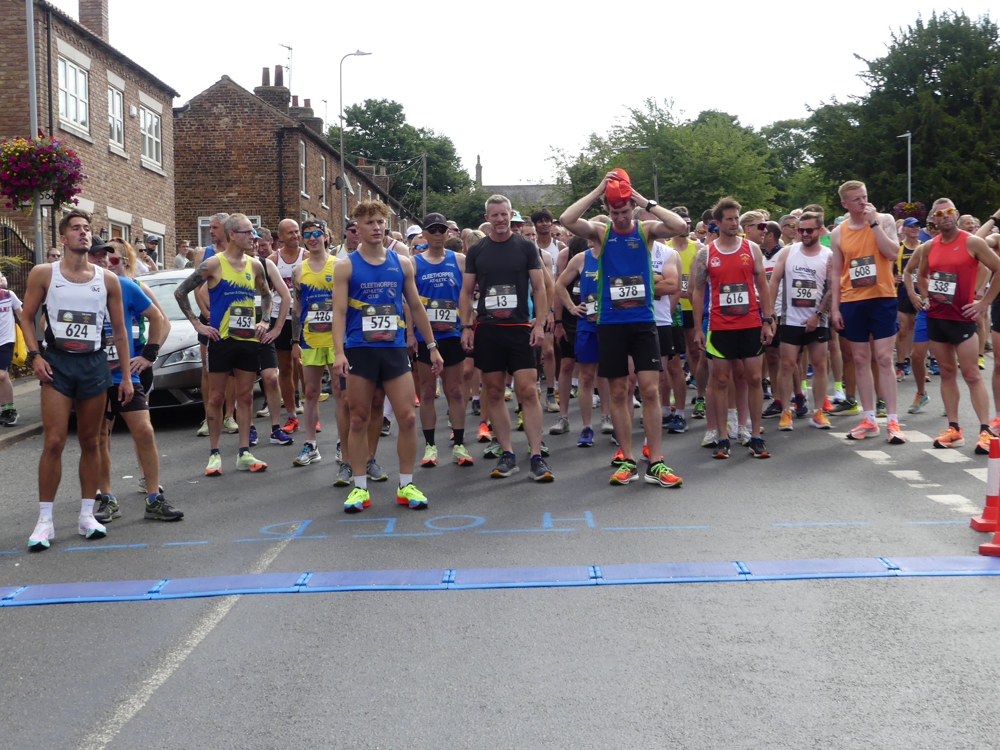
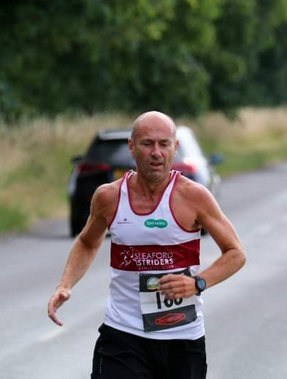
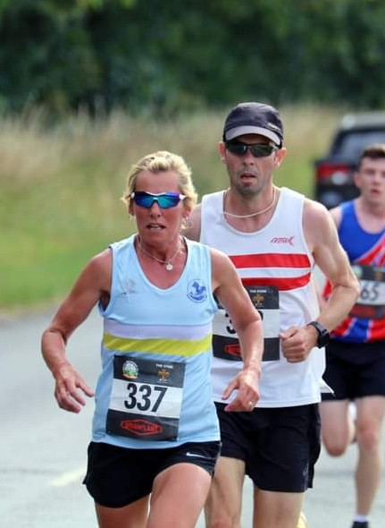

# Brianplant Sting in the Tail 10k 2022 Team Prizes & King of the Sting Awards

Congratulations to all who ran on Sunday. Please read on to see who won the team prizes and the King of the Sting yellow vests.

## Team Prizes

The team prizes were decided (as usual) by our expert race referees - and this year was a tricky one to work out, what with several early finishers not running in club colours!

- 1st Male Team (3 runners: Jordan Carlisle Steve Dring, Dominic Shum) - Cleethorpes AC
- 1st Female Team (3 runners: Rowan Booth, Meredith Donaldson, Amelia Louth) - Caistor RC

Congratulations to both teams, each member of which receives a bottle of Prosecco.

## King of the Sting Award

*Male King of the Sting, Greg Southern. Photo Credit John Ranisforth*

*Female King of the Sting, Paula Downing. Photo Credit John Ranisforth*

The "King of the Sting" was introduced last year as a special 2k section, from 8k at the bottom of Castle Hill to the race finish in the Marketplace. The award is given to the highest male and female WAVA age graded 2k performance over the race "Sting in the Tail" section.

This years' winners are:

- Paula Downing from Mablethorpe Running Club with a time of 00:09:51, age graded performance of 68.69%
- Greg Southern from Sleaford Striders AC with a time of 00:08:05, age graded performance of 68.96%

Congratulations to both Paula and Greg, who will receive the limited edition yellow "King of the Sting" vest.
