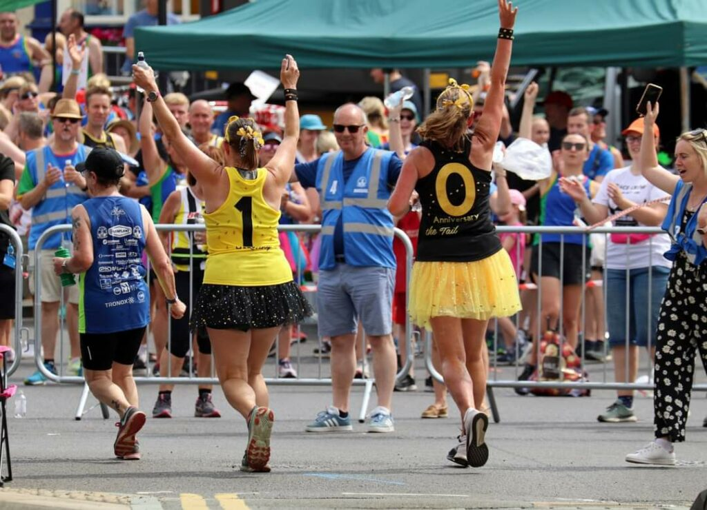
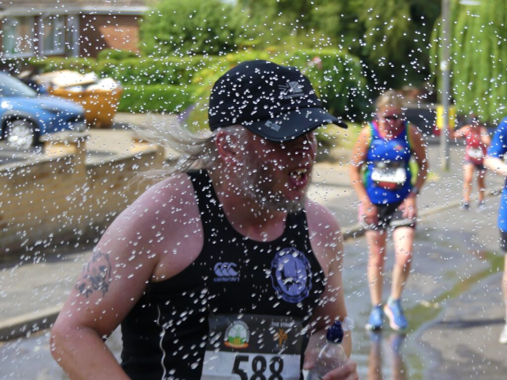
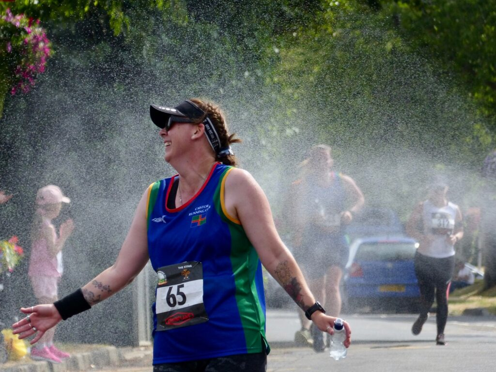
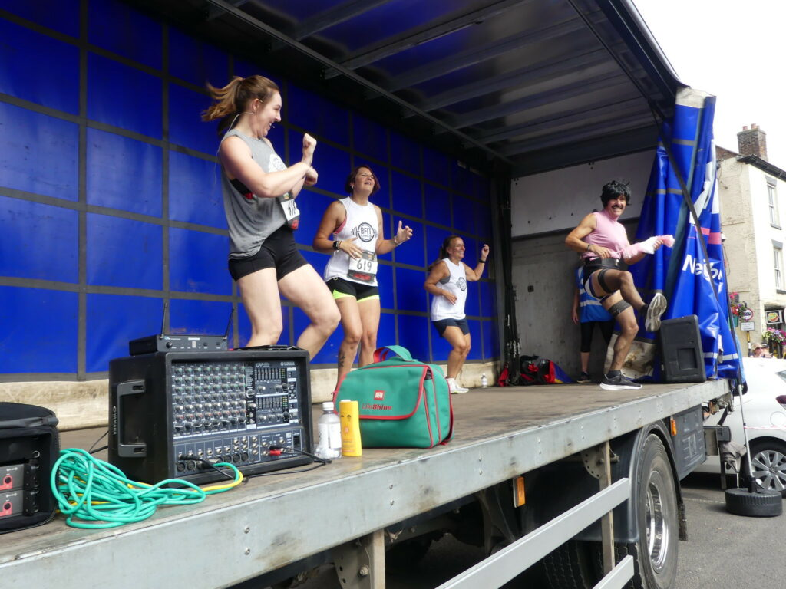

# Great Turnout for a Sunny Sting 10k & Mini Sting Fun Run 2022!

Sunday 17th July saw an excellent turnout for the Blackrow Engineering "Mini Sting" fun run and the Brianplant "Sting in the Tail 10k" race.

*Sting 10k Sweepers Celebrate 10 Years*

The town of Caistor did not disappoint, turning out in their usual masses to cheer, encourage and water the runners on what was probably one of the hottest days of the year so far.

*Runner getting a watering on the 10k course*

This event is in its 10th year and those hills in the last 2 kilometres of the 10k course never get smaller - no matter how many times you may have run the race before.

Race directors Bobby Kneale and Chris Ramsay would like to extend their thanks to the army of volunteers who made this another excellent day to remember. Huge thanks to all club members and their family and friends for helping out on the day. Special mention is also due to the small but dedicated band of folk who undertake some very important roles every year: Jill & Andy Bell, Sarah & Mike Wells, Kate & Loz Brown, Andy Knowles, Rob Crump, Fran & Chris Allison, and Neil Bennett.

*CRC member Debbie cooling down in the water*

Very special mention to local legend Rob Turner without whom we would not be able to do very many of the most important set up parts of the race, as well as keeping the ice cream frozen.

*Freddie (Captain Lincolnshire) Mercury makes an appearance at the Sting warm up*

Once again the warm up proved a worthy attraction, with an excellent muscle stretching dance provided by Amy & friends from BFit Gym and a surprise appearance from a Freddie Mercury inspired Captain Lincolnshire!
