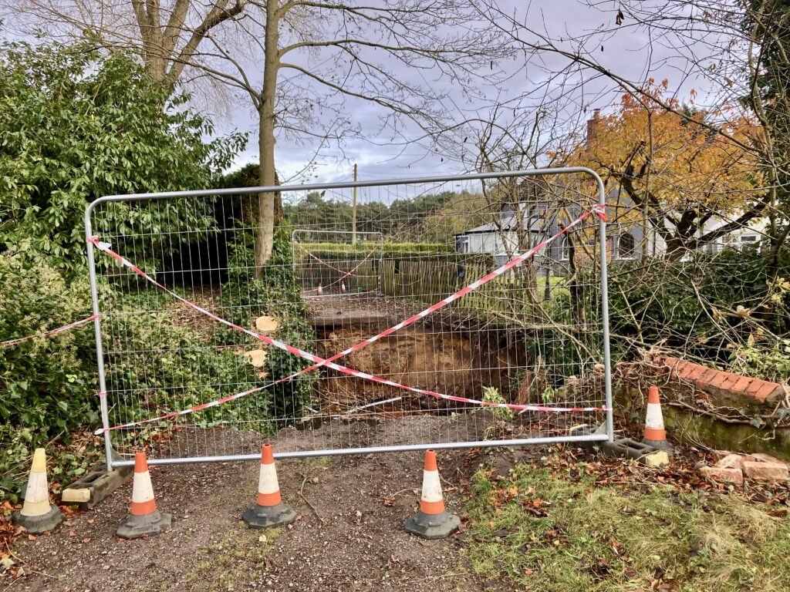
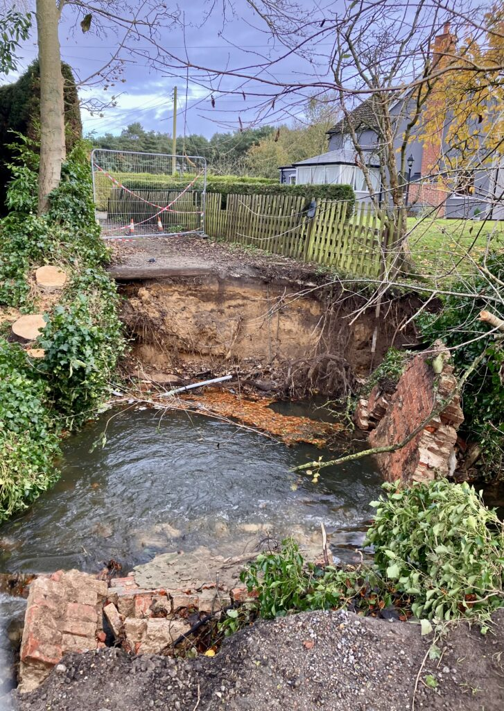

# Caistor Sting 10K 2024 - Cancelled

With regret, next year's Caistor Sting in the Tail 10K, scheduled for 30th June 2024 has been cancelled, due to the route being impassable.

As many people will be aware, in October this year Storm Babet caused significant damage locally, and destroyed the bridge used by the event to cross Nettleton Beck, near Nettleton Country House.

After consulting the landowners across whose land the Sting route runs, it's clear the route will remain unusable for the foreseeable future. Therefore we have taken the difficult decision to cancel the 2024 edition of the race. We hope the event will be able to return in 2025.

With thanks for your understanding and support.

The Sting 10K Team

 

 

