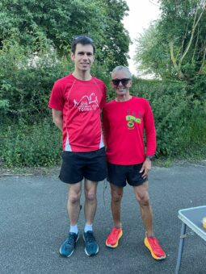

# Lincolnshire Wolds Tough 10 - 2024 Results

Many thanks to all the runners, supporters and volunteers who helped to make this year's Lincolnshire Wolds Tough 10 another great success! Congratulations to Rob Payne (54:51) and Rebecca Cole (64:10) who were first male and female across the line this year.   
  
Full Results can be viewed [here](2024-06-20-lincolnshire-wolds-tough-10-2024-results/Wolds-10-Results-2024-Final-1.pdf):   
  
  
Steve Green, long-time Race Director of the Wolds Tough Ten and Peter Dodds showing off their classic race shirts last night.
