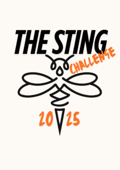

# The Sting is back! With an exciting new route for 2025!

Caistor Running Club is delighted to announce the fantastic news that  
"The Sting" is back for 2025!  
  
This year's Sting Challenge will take place at 1000am on Sunday 13th July 2025, and will be run on an updated multi-terrain route of approximately 6 miles, featuring many of the famous Caistor hills that Sting runners love, plus an entirely new section around the fields between Caistor and Nettleton which we're sure entrants will love too!   
  
This year's event sold out in record time (just 2 days!), if you missed out and would like to help out as a volunteer, [please get in touch](mailto:%20caistor.running.club@gmail.com) via email: caistor.running.club@gmail.com  
  
It's also worth checking the [Sting Facebook page](https://www.facebook.com/stingchallenge) as free transfers are available to entrants who now can't take part, if you'd like to snap up a place when they become available, that's the place to go. Transfers will close a week before the event.   
  
This year, the Sting Challenge is again delighted to run alongside the popular Caistor Goes event - this year the theme is "Caistor Goes Sporty" and there will be a whole afternoon of fun in South Street park, so please stay around after the Sting has finished. For more information on Caistor Goes Sporty, please check out the [event's Facebook page.](https://www.facebook.com/CaistorGoes?locale=en_GB)  
  
Many thanks to everyone for their support and we look forward to seeing you on 13th July!
