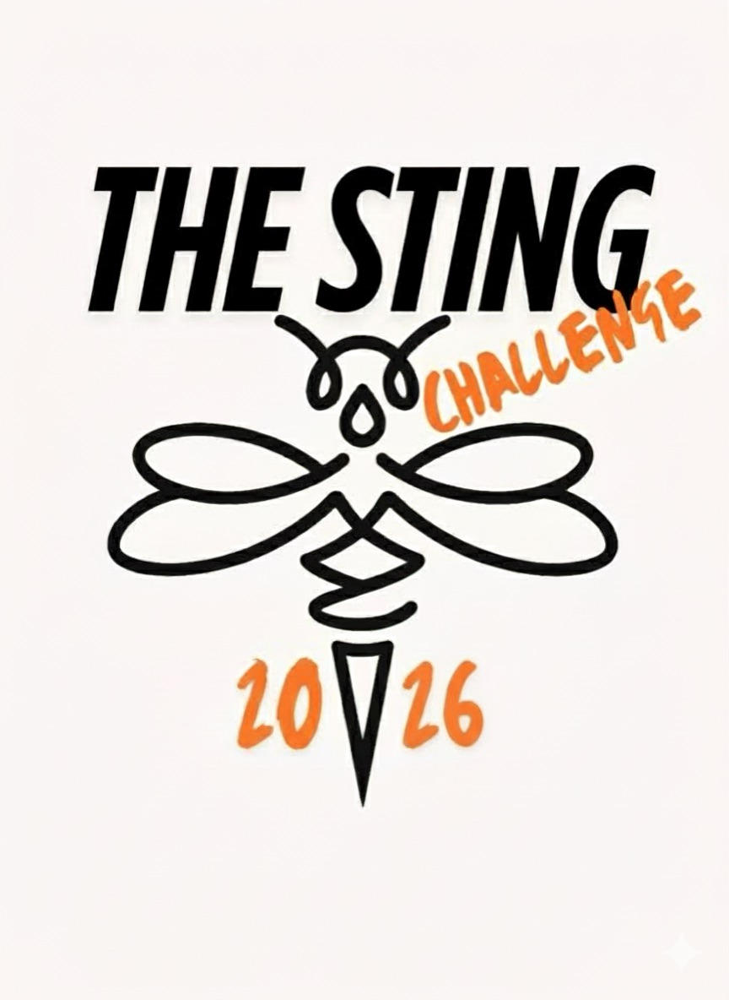

# The Sting Challenge 2026 - Entries Now Open!

Caistor Running Club is delighted to announce the fantastic news that…

**"The Sting" is back once again for 2026 and this year's event will be better than ever!** 

The Caistor Sting Challenge 2026 will take place at 1030am on Sunday 12th July 2026, and will be run on last year's incredibly popular multi-terrain route of approximately 6 miles, featuring many of the famous Caistor hills that Sting runners have always enjoyed, plus the wonderful new section around the fields between Caistor and Nettleton which last year's entrants loved too!  
  
The route map can be [**viewed here** ](2026-02-05-the-sting-challenge-2026-entries-now-open/The_Sting_Marshals_and_Signage_2026_Rev_B.png)

Last year's event sold out in record time (just 2 days!), and entries this year are sure to fly off the virtual shelves again, especially as not only have we kept the entry price at just £15, you'll also receive a **Free Ice Cream** and by popular demand, all finishers will also receive a **free iconic Sting Vest** too!

To find out more information and to enter this year's event, please go to:

[Sting Challenge 2026 Entries](https://theentrypoint.co.uk/events/caistor-sting-challenge-2026-5RAQM4lY8E9aPY0)

And to tag your friends and to invite them to join you, check out the Sting Challenge Facebook page:

[Sting Challenge on Facebook](https://www.facebook.com/stingchallenge)

This year, the Sting Challenge is again delighted to run alongside the popular Caistor Goes event and there will be a whole afternoon of fun in South Street park, so please stay around after the Sting has finished to support this great local event.

Many thanks to everyone for their support and we look forward to seeing you on Sunday 12th July!
