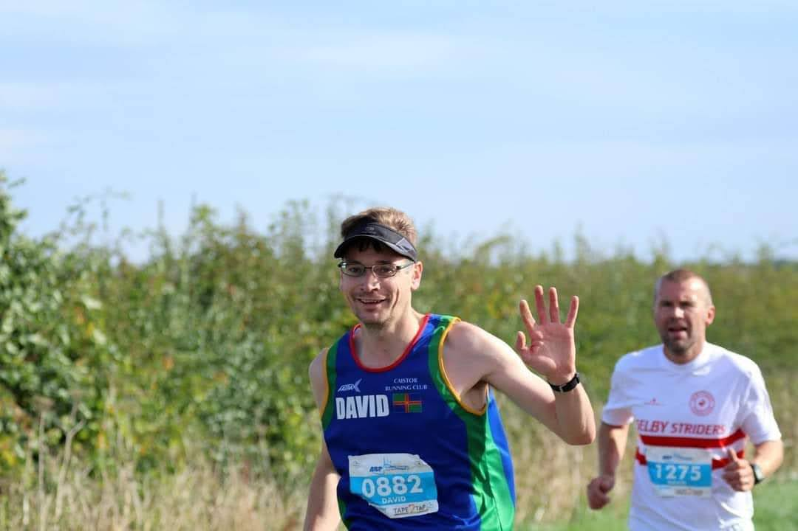
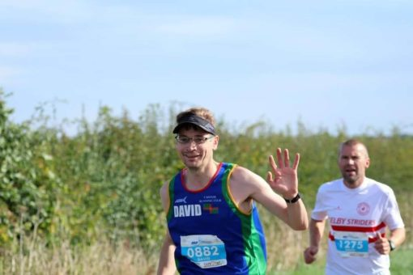

# David Mannion Memorial Mile Series 2026

The David Mannion Memorial Mile Series is back for its 5th year!

This series of three one mile races takes place on three consecutive Wednesday evenings, with the first race being held in the week after the clocks go forward. These events will take place at the Caistor Sports & Social Club sports field on a measured course. This unique series is open to CRC members only.

*David Mannion running at a local race in CRC colours.*

The dates of the series in 2026 are as follows:

- Wednesday 1st April at 18:30
- Wednesday 8th April at 18:30
- Wednesday 15th April at 18:30 (with a presentation post-race)

Runners will be ranked on their highest age grade score across the race series - so come and have as many goes as you want!  
  
There will be one male and one female shield which will be engraved with the year and the winner's name.

These 2 shields have been very kindly donated to the club by Moira Westley and Rob Cartwright.

The winner of one year will be ineligible to enter the following year and instead encouraged to volunteer. Thereafter they may compete again.  
  
To enter this year's races, please **[click here ](https://docs.google.com/forms/d/e/1FAIpQLScgiQQLve4PnMUziar1aslAmgebGV7PJIRaMTwxGgYHfurc5A/viewform?usp=sf_link)  
**  
There will be no race fee: runners wanting to take part are asked to make a donation to charity instead of an entry fee. This year, we've decided to support [Movember](https://www.justgiving.com/page/caistor-running-club-dmm2026) and their fundraising for men's health issues Entrants can donate via [JustGiving to Movember](https://www.justgiving.com/page/caistor-running-club-dmm2026), and Caistor Running Club will make a donation equal to the same amount to the local charity A Platform To Talk

- [Donate to Movember](https://www.justgiving.com/page/caistor-running-club-dmm2026)

Although much of the above is regarding the winners, we hope that this will be a fun event with an encouraging and supportive atmosphere for all who take part.   
  
Please note that the Caistor Sports and Social Club will be open; we are encouraging people to use the facilities and make these social events as much as a races.  
  
If you'd like to help out at this year's event, please add your name to [this spreadsheet](https://docs.google.com/spreadsheets/d/1oCLmiDDu2djZB_Y2EJLv06PhFe_jKXVKLbx8xCf207M/edit?usp=sharing)
